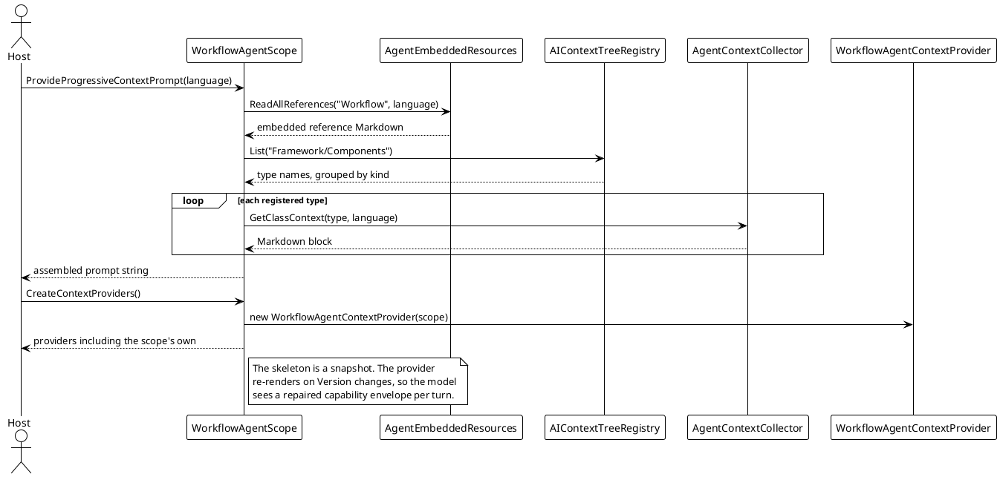
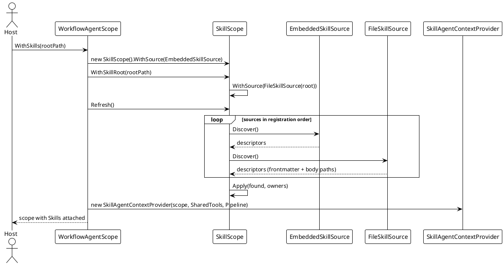
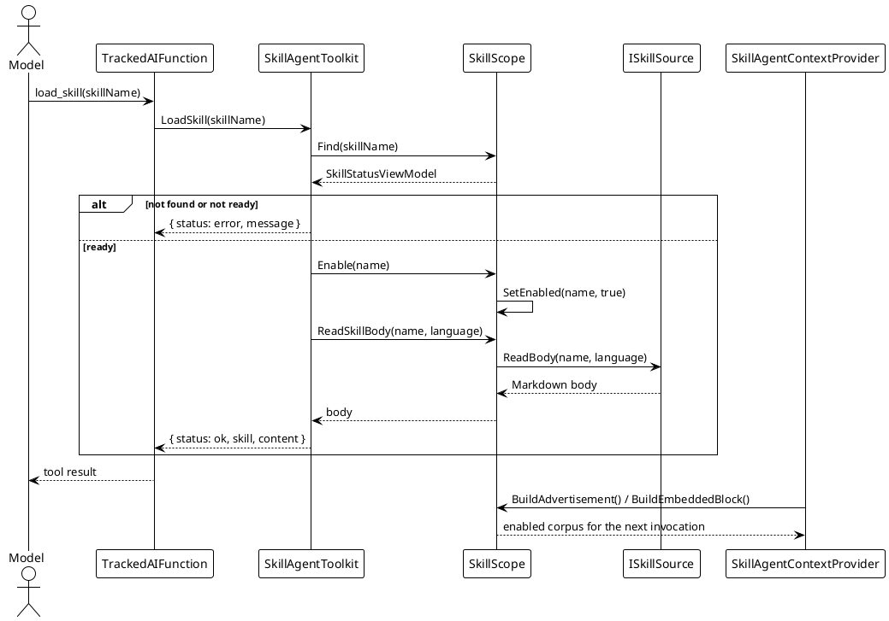

# 智能体上下文与技能

本页追踪两条相关链路。第一条构建宿主冻进智能体指令的提示文本；第二条挂载技能语料、发现它，并以四个工具的形式暴露给模型。

上下文与技能是两个独立子系统；它们都被组合进同一个 `WorkflowAgentScope`，并通过 `AIContextProvider` 贡献内容。

## 渐进式上下文

`ProvideProgressiveContextPrompt` 是低 token 形态：一段固定的行为前言、框架自带的参考文档，然后是每个已注册组件类型的一行摘要。完整类型表刻意不预载；模型被告知，当类型形状重要时调用 `GetComponentContext`。

Source: `Src/Core/VeloxDev.Core.Extension/Agent/Workflow/WorkflowAgentScope.cs:1309-1433`

```csharp
public string ProvideProgressiveContextPrompt(AgentLanguages language)
{
    var result = new StringBuilder();

    result.AppendLine("# Workflow Agent Context (Progressive)");
    result.AppendLine();
    // ... behavioral constraints, failure protocol ...
    result.AppendLine(AgentEmbeddedResources.ReadAllReferences(SystemName, language).TrimEnd());
    // ... registered type summaries ...
    AppendPreloadedComponentSummaries(result);
    AppendCustomToolsSection(result);
    result.AppendLine(BuildInteractionSafetyPrompt(language));
    AppendEmbeddedSkills(result, language);
    CaptureSkeletonReceipt(language);
    return result.ToString();
}
```

逐类型渲染器是静态且语言感知的。`ProvideFrameworkContext` 遍历智能体上下文树的 `Framework/` 目录，因此一个新增 `[AgentContext]` 的框架类型无需手维护列表就会出现在这里。

Source: `Src/Core/VeloxDev.Core.Extension/Agent/Workflow/WorkflowAgentScope.cs:1472-1499`

```csharp
public string ProvideFrameworkContext(AgentLanguages language = AgentLanguages.English)
{
    var result = new StringBuilder();
    var root = AIContextTreeRegistry.FrameworkRoot;

    foreach (var name in TreeTypeNames($"{root}/Enums"))
        if (AgentTypeResolver.ResolveType(name) is { } t)
            result.AppendLine(AgentContextCollector.GetEnumContext(t, language));
    // ... interfaces and components ...
    return result.ToString();
}
```



作用域暴露 `Version`，一个由每次配置 setter 推进的单调计数。上下文 provider 以它为缓存键，因此智能体建好之后做出的变更，会在下一次调用到达模型，而无需重建智能体。

Source: `Src/Core/VeloxDev.Core.Extension/Agent/Workflow/WorkflowAgentScope.cs:1605`, `1985-2002`

```csharp
public long Version => Interlocked.Read(ref _version);

public IReadOnlyList<AIContextProvider> CreateContextProviders()
{
    var providers = new List<AIContextProvider>();
    if (_compactionProvider is not null) providers.Add(_compactionProvider);
    providers.Add(CreateContextProvider());
    if (_skillProvider is not null) providers.Add(_skillProvider);
    if (_mcpProvider is not null) providers.Add(_mcpProvider);
    if (_subAgentProvider is not null) providers.Add(_subAgentProvider);
    // ... todo, agent-mode, host factories ...
    return providers;
}
```

## 技能发现

`WithSkills(string)` 创建 `SkillScope`，把库自带的内嵌语料作为一个来源，把文件根作为另一个来源，然后刷新。`Refresh` 向每个来源索要描述符；最先声明某个名字的来源拥有它，但同一来源的多语言变体都会保留。

Source: `Src/Core/VeloxDev.Core.Extension/Agent/Workflow/WorkflowAgentScope.cs:1655-1665`

```csharp
public WorkflowAgentScope WithSkills(string rootPath)
{
    var skills = Skills ??= new SkillScope().WithSource(new EmbeddedSkillSource(SystemName));
    skills.WithSynchronizationContext(UIContext);
    skills.WithPromptLanguage(_defaultLanguage);
    skills.WithSkillRoot(rootPath);
    skills.Refresh();
    return AttachSkillProvider();
}
```

Source: `Src/Core/VeloxDev.Core.Extension/Agent/Skills/SkillScope.cs:160-200`

```csharp
public void Refresh()
{
    ISkillSource[] sources;
    lock (_gate) sources = [.. _sources];

    var found = new List<SkillDescriptor>();
    var owners = new Dictionary<string, ISkillSource>(StringComparer.OrdinalIgnoreCase);

    foreach (var source in sources)
    {
        IReadOnlyList<SkillDescriptor> discovered;
        try { discovered = source.Discover(); }
        catch (Exception ex)
        {
            found.Add(new SkillDescriptor { /* error descriptor */ });
            continue;
        }
        // ... first source to declare a name owns it ...
    }

    Apply(found, owners);
}
```



抛异常的来源不会拖垮其他来源。它贡献一个错误描述符，于是 `ListSkills` 显示失败，而不是静默丢掉一份语料。

## 四个技能工具

`SkillAgentContextProvider` 贡献 `ListSkills`、`load_skill`、`UnloadSkill` 与 `read_skill_resource`。它们用作用域共享的 `ToolPipeline` 包装，因此与工作流内置工具一样被编组、拦截与计数。

Source: `Src/Core/VeloxDev.Core.Extension/Agent/Skills/SkillAgentToolkit.cs:48-73`

```csharp
public static readonly string[] ToolNames =
    ["ListSkills", "load_skill", "UnloadSkill", "read_skill_resource"];

public IList<AITool> CreateTools(ToolPipeline tools, AgentPipeline? pipeline = null)
{
    if (tools is null) throw new ArgumentNullException(nameof(tools));
    return [.. CreateTools().Select(tool =>
        tool is AIFunction function ? (AITool)new TrackedAIFunction(function, tools, pipeline) : tool)];
}
```

`load_skill` 启用技能并返回正文；启用标志才是让指导在下一轮生效的东西。`UnloadSkill` 只翻转标志，不重新发现任何东西。

Source: `Src/Core/VeloxDev.Core.Extension/Agent/Skills/SkillAgentToolkit.cs:106-129`

```csharp
private string LoadSkill(string skillName)
{
    var skill = _scope.Find(skillName);
    if (skill is null) return Error($"Skill '{skillName}' not found. Use ListSkills to see the available skills.");
    if (!skill.IsReady) return Error($"Skill '{skillName}' is not readable: {skill.Error ?? skill.StateText}");

    _scope.Enable(skill.Name);

    var body = _scope.ReadSkillBody(skill.Name, Language);
    if (string.IsNullOrWhiteSpace(body)) return Error($"Skill '{skillName}' is marked ready but produced no text.");

    return new VeloxJsonObject
    {
        ["status"] = "ok",
        ["skill"] = skill.Name,
        ["content"] = body,
    }.ToJson();
}
```



provider 每次重渲染都会读取启用标志。内嵌技能启用时整篇注入；文件技能只按名称与描述广告，正文只能经 `load_skill` 读取。

## 相关

- [工作流智能体工具](../17_工作流智能体工具/index.md) —— 这些工具加入的 toolkit。
- [智能体安全与预算](../18_智能体安全与预算/index.md) —— 同样拦截技能工具的管线。
- [MCP 集成](../20_MCP集成/index.md) —— 平行的自助子系统。
- [子智能体](../21_子智能体/index.md) —— 子智能体收到收窄后的技能视图。
