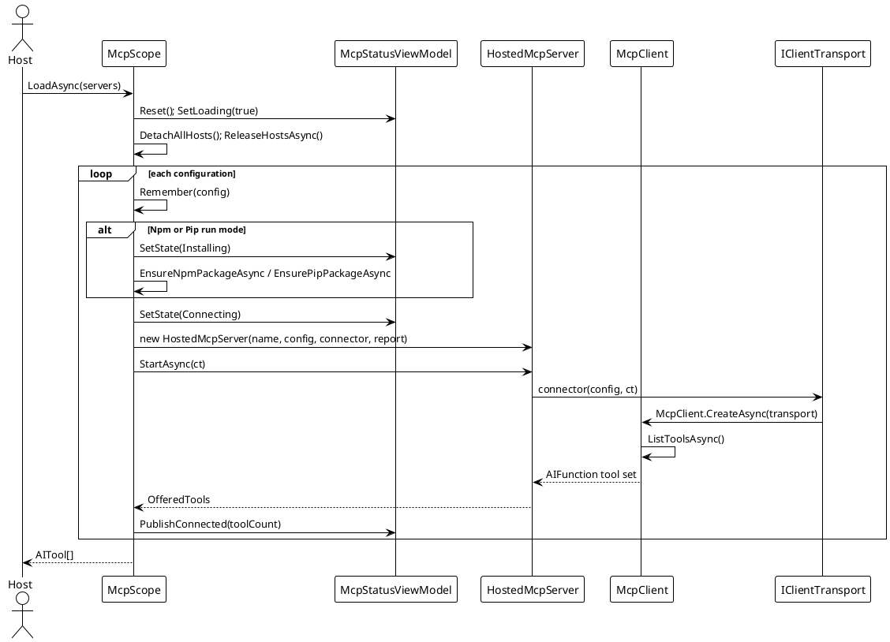
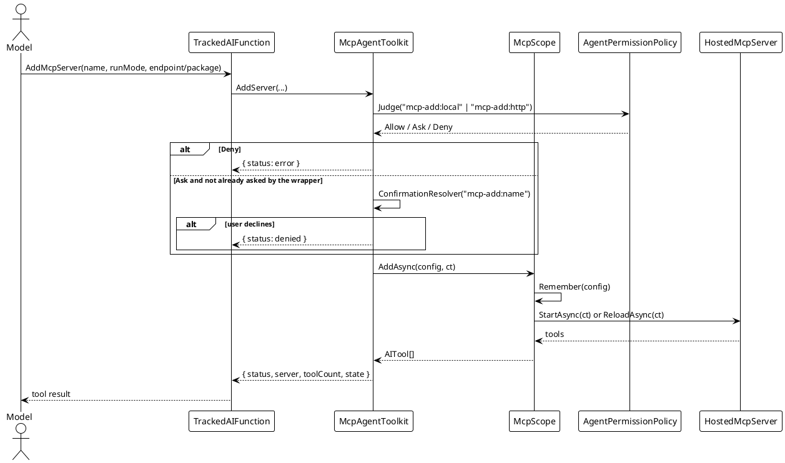

# MCP 集成

本页追踪 MCP 生命周期：加载配置、启动或连接服务器、发布其工具，以及能在会话中途添加或重配服务器的智能体管理工具。

`McpScope` 拥有共享数据层（注册、状态行、已加载工具集）。`HostedMcpServer` 拥有单个服务器的活动客户端与惰性重建。

## 加载服务器

`LoadAsync` 是替换语义：它先摘除并释放所有旧宿主，再加载新列表，因此重载不会遗留 stdio 子进程。

Source: `Src/Core/VeloxDev.Core.Extension/Agent/MCP/McpScope.cs:778-806`

```csharp
public async Task<AITool[]> LoadAsync(
    IEnumerable<McpServerConfiguration> servers, CancellationToken ct = default)
{
    var mcpRoot = ResolveMcpRoot();

    await RunOnUIAsync(() => { Status.Reset(); Status.SetLoading(true); }).ConfigureAwait(false);
    await ReleaseHostsAsync(DetachAllHosts()).ConfigureAwait(false);
    lock (_loadedToolsLock)
        _loadedToolSets.Clear();
    try
    {
        var allTools = new List<AITool>();
        foreach (var config in servers)
        {
            if (config is null) continue;
            Remember(config);
            allTools.AddRange(await LoadOneAsync(config, mcpRoot, ct).ConfigureAwait(false));
        }
        return [.. allTools];
    }
    finally
    {
        await RunOnUIAsync(() => Status.SetLoading(false)).ConfigureAwait(false);
    }
}
```

`LoadOneAsync` 区分首次加载与重配。本地运行模式会在任何连接之前安装运行时；首次加载随后构造 `HostedMcpServer` 并启动它。

Source: `Src/Core/VeloxDev.Core.Extension/Agent/MCP/McpScope.cs:897-955`

```csharp
if (existing is not null)
{
    existing.SetConfiguration(config);
    await SetServerStateAsync(status, McpServerStatus.Connecting).ConfigureAwait(false);
    return await existing.ReloadAsync(ct).ConfigureAwait(false) ? [.. existing.OfferedTools] : [];
}

if (config.RunMode is McpServerRunMode.Npm or McpServerRunMode.Pip)
{
    await SetServerStateAsync(status, McpServerStatus.Installing).ConfigureAwait(false);
    if (config.RunMode == McpServerRunMode.Npm)
        await EnsureNpmPackageAsync(config.Package, config.Version, mcpRoot, ct).ConfigureAwait(false);
    else
        await EnsurePipPackageAsync(config.Package, config.Version, mcpRoot, ct).ConfigureAwait(false);
}

await SetServerStateAsync(status, McpServerStatus.Connecting).ConfigureAwait(false);
var host = new HostedMcpServer(config.Name, config, BindConnector(mcpRoot), ReportFor(config.Name));
var tools = await host.StartAsync(ct).ConfigureAwait(false);
```



连接器为所有本地运行模式构建 stdio 传输，为 `Http` 构建 HTTP 传输。所有本地模式最终解析成同一对 `(command, arguments)`，再走同一个 `StdioClientTransport`；模式只是在自己的安装/启动包装前加一层。

Source: `Src/Core/VeloxDev.Core.Extension/Agent/MCP/McpScope.cs:1235-1263`, `1298-1312`

```csharp
var transport = config.RunMode == McpServerRunMode.Http
    ? (IClientTransport)CreateHttpTransport(config)
    : CreateStdioTransport(config, mcpRoot);

var client = await McpClient.CreateAsync(transport, options, null, connectCt).ConfigureAwait(false);
try
{
    var tools = await client.ListToolsAsync().ConfigureAwait(false);
    return new McpConnection(client, [.. tools.Cast<AIFunction>()]);
}
catch { await SafeDisposeAsync(client).ConfigureAwait(false); throw; }
```

```csharp
var (cmd, args) = config.RunMode switch
{
    McpServerRunMode.Normal => BuildNormalArgs(config),
    McpServerRunMode.Npx    => BuildNpxArgs(config),
    McpServerRunMode.Uvx    => BuildUvxArgs(config),
    McpServerRunMode.Dotnet => BuildDotnetArgs(config, mcpRoot),
    McpServerRunMode.Pip    => BuildPipArgs(config, mcpRoot),
    McpServerRunMode.Exe    => BuildExeArgs(config, mcpRoot),
    _                       => BuildNpmArgs(config, mcpRoot),
};
```

连接失败记录在该服务器的状态行上，并通过 `ServerError` 上报。它不贡献工具，但仍推进 `Version`，于是以版本为键的上下文 provider 会重渲染。

Source: `Src/Core/VeloxDev.Core.Extension/Agent/MCP/McpScope.cs:942-953`

```csharp
catch (Exception ex) when (ex is not OperationCanceledException)
{
    await RunOnUIAsync(() =>
    {
        status.Error = ex.Message;
        status.State = McpServerStatus.Error;
    }).ConfigureAwait(false);
    ServerError?.Invoke(config, ex);
    Interlocked.Increment(ref _version);
    return [];
}
```

## 会话中途添加服务器

`AddMcpServer` 不是原始透传。它先就服务器的*种类*（本地还是远程）询问权限策略，因为本地包会安装并运行软件，而 HTTP 端点只把数据发出去。种类特定的 `Ask` 规则是包装器看不到的唯一情况，此时工具自己询问确认解析器。

Source: `Src/Core/VeloxDev.Core.Extension/Agent/MCP/McpAgentToolkit.cs:237-299`

```csharp
var kind = mode == McpServerRunMode.Http ? HttpKind : LocalKind;
var kindArguments = new Dictionary<string, object?> { ["name"] = name, ["runMode"] = mode.ToString() };
var verdict = _scope.Judge(kind, kindArguments);
if (verdict == PermissionDecision.Deny)
{
    return Error(mode == McpServerRunMode.Http
        ? "Adding remote MCP servers is refused by host policy (a deny rule naming 'mcp-add:http')."
        : $"Adding a locally launched '{mode}' server is refused by host policy ...");
}

var alreadyAsked = _scope.IsComposed && _scope.Judge(nameof(AddServer), kindArguments) == PermissionDecision.Ask;
if (!_scope.IsComposed || (verdict == PermissionDecision.Ask && !alreadyAsked))
{
    if (!await _scope.ConfirmationResolver($"mcp-add:{name}", description))
        return /* denied envelope */;
}

var tools = await _scope.AddAsync(config, ct);
```



`SetMcpServerArguments` 刻意更窄：只改启动参数，其余全部原样保留，因此一次笔误不能把 npx 服务器悄悄变成别的东西。

## 工具与宿主工具重建

重建的安全性在 `HostedMcpServer`。重建先连接新配置，然后才采纳它；旧客户端被退休，并在在途调用排空后释放。

重建路径是 `EnsureCurrentAsync` / `Adopt`；调用时入口是 `InvokeAsync`。

Source: `Src/Core/VeloxDev.Core.Extension/Agent/MCP/HostedMcpServer.cs:218-251`

```csharp
internal async ValueTask<object?> InvokeAsync(string toolName, AIFunctionArguments arguments, CancellationToken ct)
{
    if (RebuildOwed())
    {
        var rebuilt = false;
        await _gate.WaitAsync(ct).ConfigureAwait(false);
        try { rebuilt = await EnsureCurrentAsync(ct, force: false).ConfigureAwait(false); }
        finally { _gate.Release(); }
        if (rebuilt) _report(Phase.Refreshed, Configuration, null);
    }

    var live = Volatile.Read(ref _liveForInvoke);
    if (live is null || !live.TryGetValue(toolName, out var tool))
        return Error($"Server '{_name}' no longer offers a tool named '{toolName}' ...");

    Interlocked.Increment(ref _inFlight);
    try { return await tool.InvokeAsync(arguments, ct).ConfigureAwait(false); }
    finally { if (Interlocked.Decrement(ref _inFlight) == 0) await ReleaseRetiredAsync().ConfigureAwait(false); }
}
```

管理 toolkit 在每个作用域都注册读取工具，包括交给子智能体的受限视图；加载与卸载只存在于拥有服务器的 scope 上。资源与提示总是可用，因为只暴露资源而没有工具的服务器否则对模型不可见。

Source: `Src/Core/VeloxDev.Core.Extension/Agent/MCP/McpAgentToolkit.cs:131-161`

```csharp
var tools = new List<AITool> { AIFunctionFactory.Create(ListServers, ListName) };

if (!_scope.IsGrantedView)
{
    tools.Add(AIFunctionFactory.Create(LoadServers, LoadName));
    tools.Add(AIFunctionFactory.Create(UnloadServer, UnloadName));
}
tools.Add(AIFunctionFactory.Create(DescribeServer, DescribeName));
tools.Add(AIFunctionFactory.Create(ListResources, ListResourcesName));
tools.Add(AIFunctionFactory.Create(ReadResource, ReadResourceName));
tools.Add(AIFunctionFactory.Create(ListPrompts, ListPromptsName));
tools.Add(AIFunctionFactory.Create(GetPrompt, GetPromptName));
```

上下文 provider 每次渲染都重建 toolkit，而不是建一次，因为宿主可能在 provider 构造之后才注册配置。

Source: `Src/Core/VeloxDev.Core.Extension/Agent/MCP/McpAgentContextProvider.cs:63-99`

```csharp
private McpAgentToolkit CreateToolkit() => new(_scope, _scope.RegisteredServers);

internal AIContext BuildContext()
{
    var version = _scope.Version;
    lock (_gate)
    {
        if (_renderedFor != version)
        {
            var toolkit = CreateToolkit();
            _instructions = BuildInstructions(toolkit);
            _tools = BuildTools(toolkit);
            _renderedFor = version;
        }
        return new AIContext { Instructions = _instructions, Tools = _tools };
    }
}
```

## 相关

- [智能体安全与预算](../18_智能体安全与预算/index.md) —— 裁决 `mcp-add:*` 种类的策略。
- [智能体上下文与技能](../19_智能体上下文与技能/index.md) —— 平行的 provider 缓存子系统。
- [子智能体](../21_子智能体/index.md) —— 被授予的 MCP 服务器以只读视图到达。
- [无头 CLI](../23_无头CLI/index.md) —— 一个*作为* MCP 服务器而非客户端运行的进程。
