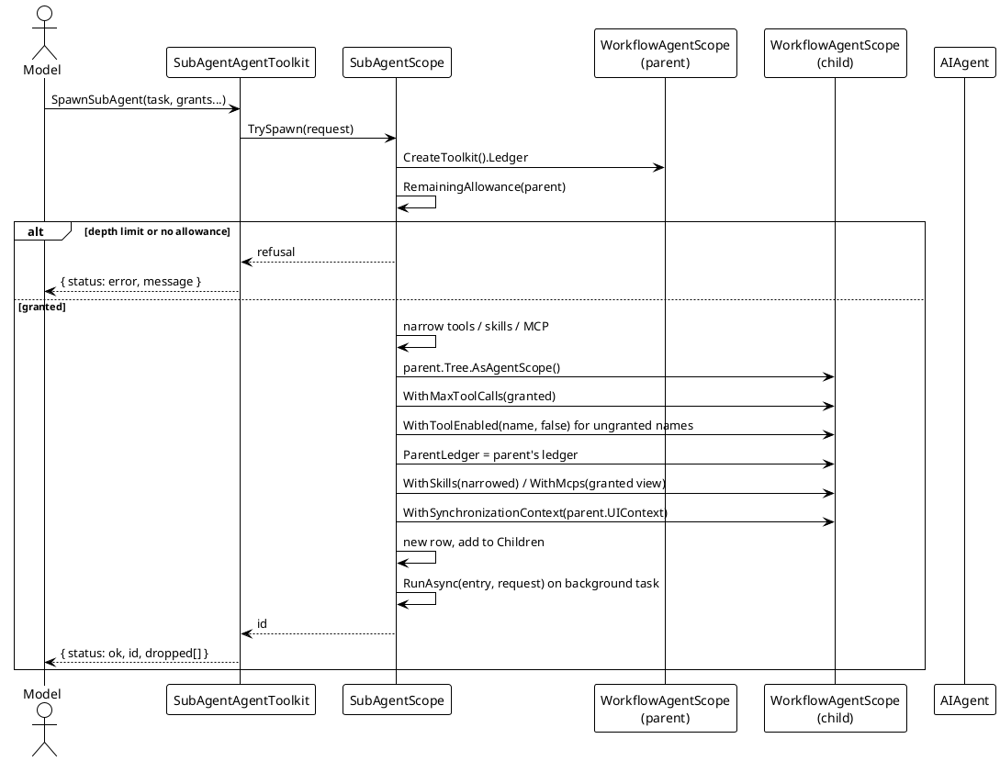
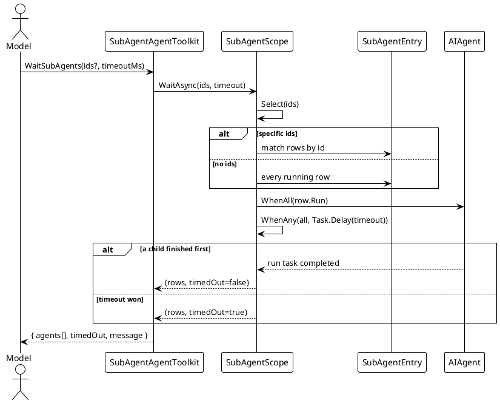

# 子智能体

本页追踪一次派发：父级如何把能力与预算收窄成子作用域、子级后台运行如何启动，以及 `WaitSubAgents` 如何收集结果而无需轮询。

`SubAgentScope` 拥有名册与授权逻辑。`SubAgentAgentToolkit` 是模型面向它的门面。

## 派发子智能体

`TrySpawn` 就是整套授权算法。它计算剩余额度、收窄工具/技能/MCP 服务器、记录被丢弃项、构建子作用域并启动后台运行。

Source: `Src/Core/VeloxDev.Core.Extension/Agent/SubAgents/SubAgentScope.cs:438-468`

```csharp
internal string? TrySpawn(SubAgentRequest request, out string? refusal)
{
    refusal = null;
    var parent = _parent ?? throw new InvalidOperationException(...);

    if (_disposed) { refusal = "This session has been disposed; no further sub-agents can be spawned."; return null; }
    if (!CanSpawn)
    {
        refusal = $"Sub-agents cannot be spawned this deep: the limit is {MaxDepth} and this agent is at depth {Depth}. ...";
        return null;
    }

    var dropped = new List<string>();
    var parentLedger = parent.CreateToolkit().Ledger;
    var remaining = RemainingAllowance(parent, parentLedger);
    var granted = Math.Min(request.MaxToolCalls ?? remaining, remaining - 1);
    if (granted < 1) { refusal = "No tool-call allowance remains ..."; return null; }
    // ...
}
```

工具默认*继承*：子级拿到父级当前全部表面，减去父级自己关掉的项。点名工具是唯一拿走能力的方式。清零预算的逃生工具即使空白授权也会加上，以便子级申请更大预算。

Source: `Src/Core/VeloxDev.Core.Extension/Agent/SubAgents/SubAgentScope.cs:478-527`

```csharp
var parentToolkit = parent.CreateToolkit();
var everyName = parentToolkit.CreateAllTools().Select(t => t.Name).ToList();
if (parent.Skills is not null) everyName.AddRange(SkillAgentToolkit.ToolNames);
everyName.AddRange(SubAgentAgentToolkit.ToolNames);
// ... MCP names from parent.Mcp.LoadedTools ...

var available = everyName.Where(parent.IsToolEnabled).ToList();
List<string> grantedTools;
if (request.AllowedTools is { } wanted)
{
    grantedTools = [.. wanted
        .Where(name => available.Contains(name, StringComparer.OrdinalIgnoreCase))
        .Select(name => Canonical(name, available))];
    foreach (var name in wanted.Where(name => !available.Contains(name, StringComparer.OrdinalIgnoreCase)))
        dropped.Add($"{name}: not available to this agent, or switched off by the host");
}
else
{
    grantedTools = [.. available];
}

if (!grantedTools.Any(n => string.Equals(n, WorkflowAgentToolkit.ResetBudgetToolName, StringComparison.OrdinalIgnoreCase)))
    grantedTools.Add(WorkflowAgentToolkit.ResetBudgetToolName);
```

子账本在子 toolkit 存在*之前*就串到父账本，因此它的第一次调用已经记在整棵树上，而不是私有计数器。

Source: `Src/Core/VeloxDev.Core.Extension/Agent/SubAgents/SubAgentScope.cs:599-640`

```csharp
child.ParentLedger = parentLedger;
child.WithSynchronizationContext(parent.UIContext);

var transcript = new AgentTranscript();
child.WithTranscript(transcript);

var id = Guid.NewGuid().ToString("N");
var grand = new SubAgentScope(_agentFactory, _instructions) { Depth = childDepth, SelfId = id, Briefing = ... };
grand.InheritFrom(this);
child.WithSubAgents(grand);
```



子智能体由宿主提供的工厂构建。`ForClient` 在共享 `IChatClient` 上构建；`ForClientFactory` 按请求的模型选择客户端。两者都给子级 `scope.CreateContextProviders()` 与同一条管线。

Source: `Src/Core/VeloxDev.Core.Extension/Agent/SubAgents/SubAgentScope.cs:185-217`

```csharp
public static SubAgentScope ForClient(IChatClient client, string? instructions = null)
{
    if (client is null) throw new ArgumentNullException(nameof(client));
    return new SubAgentScope(scope => client
        .AsAIAgent(scope.CreateContextProviders(), instructions ?? DefaultInstructions)
        .WithPipeline(scope.Pipeline));
}
```

## 后台运行

运行刻意保持简单：构建智能体、等待一次 `RunAsync`、在名册线程上结束行。状态最后写，在载荷之后，因此读到通知的面板不会看到已完成却没有结果的行。

Source: `Src/Core/VeloxDev.Core.Extension/Agent/SubAgents/SubAgentScope.cs:853-878`

```csharp
private async Task RunAsync(SubAgentEntry entry, SubAgentRequest request)
{
    await OnRosterThread(() =>
    {
        entry.Row.StartedAt = DateTimeOffset.Now;
        entry.Row.State = SubAgentState.Running;
    }).ConfigureAwait(false);

    try
    {
        var agent = _agentFactory(entry.Scope, request.Model);
        var response = await agent.RunAsync(request.Task, cancellationToken: entry.Cancellation.Token).ConfigureAwait(false);
        await OnRosterThread(() => Finish(entry, response.Text, response.Usage, null, cancelled: false)).ConfigureAwait(false);
    }
    catch (OperationCanceledException)
    {
        await OnRosterThread(() => Finish(entry, null, null, null, cancelled: true)).ConfigureAwait(false);
    }
    catch (Exception ex)
    {
        await OnRosterThread(() => Finish(entry, null, null, ex, cancelled: false)).ConfigureAwait(false);
    }
}
```

## 等待与收集

`WaitSubAgents` 是对子任务的一次长等待，不是轮询循环。`Task.WhenAny` 让组合任务与延时赛跑；超时返回当前行并标记仍在运行者。

Source: `Src/Core/VeloxDev.Core.Extension/Agent/SubAgents/SubAgentScope.cs:963-978`

```csharp
internal async Task<(IReadOnlyList<SubAgentSummary> Rows, bool TimedOut)> WaitAsync(string[]? ids, int timeoutMs)
{
    var targets = Select(ids);
    if (targets.Count > 0)
    {
        var all = Task.WhenAll(targets.Select(t => t.Run ?? Task.CompletedTask));
        var finished = await Task.WhenAny(all, Task.Delay(Math.Max(0, timeoutMs))).ConfigureAwait(false);
        // ... reference comparison decides which task won ...
    }
    // ...
}
```



`GetSubAgentResult` 重读一行并返回至多调用方上限的完整报告；`WaitSubAgents` 把预览截到 4000 字符。`CancelSubAgent` 取消子级的 `CancellationTokenSource`；运行的取消路径记录 `Cancelled`，它与 `Failed` 是不同状态。

Source: `Src/Core/VeloxDev.Core.Extension/Agent/SubAgents/SubAgentAgentToolkit.cs:146-189`

```csharp
private async Task<string> WaitSubAgents(string[]? ids = null, int? timeoutMs = null)
{
    var timeout = Math.Max(0, timeoutMs ?? 60_000);
    var (rows, timedOut) = await _scope.WaitAsync(ids, timeout).ConfigureAwait(false);

    var agents = new VeloxJsonArray();
    foreach (var row in rows)
    {
        var agent = new VeloxJsonObject
        {
            ["id"] = row.Id,
            ["name"] = row.Name,
            ["depth"] = row.Depth,
            ["state"] = row.State.ToString(),
            ["callCount"] = row.CallCount,
        };
        // ... result, error, dropped ...
        agents.Add(agent);
    }
    return new VeloxJsonObject { ["status"] = "ok", ["timedOut"] = timedOut, ["agents"] = agents }.ToJson();
}
```

## 名册与树

`Children` 绑定在名册线程；`Snapshot` 是不可变副本，任何线程都可安全读取。树视图模型是扁平名册的投影：`ParentId` 就是全部父子关系。

Source: `Src/Core/VeloxDev.Core.Extension/Agent/SubAgents/SubAgentStatus.cs:35-56`

```csharp
public sealed class SubAgentSummary
{
    public string Id { get; set; } = string.Empty;
    public string Name { get; set; } = string.Empty;
    public string? ParentId { get; set; }
    public int Depth { get; set; }
    public string Task { get; set; } = string.Empty;
    public SubAgentState State { get; set; }
    // ...
}
```

## 相关

- [工作流智能体工具](../17_工作流智能体工具/index.md) —— 子级继承的工具面。
- [智能体安全与预算](../18_智能体安全与预算/index.md) —— 约束整棵树的账本链。
- [智能体上下文与技能](../19_智能体上下文与技能/index.md) —— 子级收到的收窄技能视图。
- [MCP 集成](../20_MCP集成/index.md) —— 被授予的服务器变成只读视图。
- [智能体仪表盘与转录](../22_智能体仪表盘与转录/index.md) —— 镜像此名册的面板。
