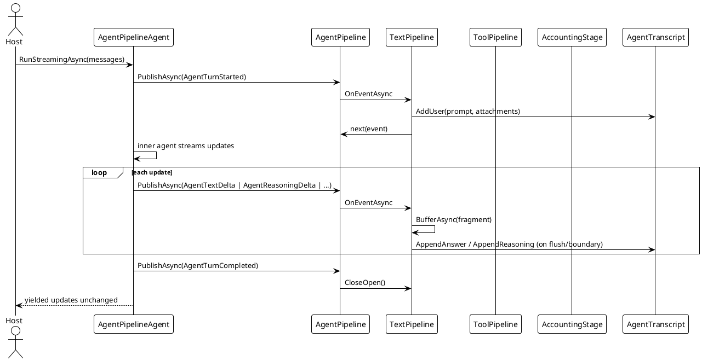
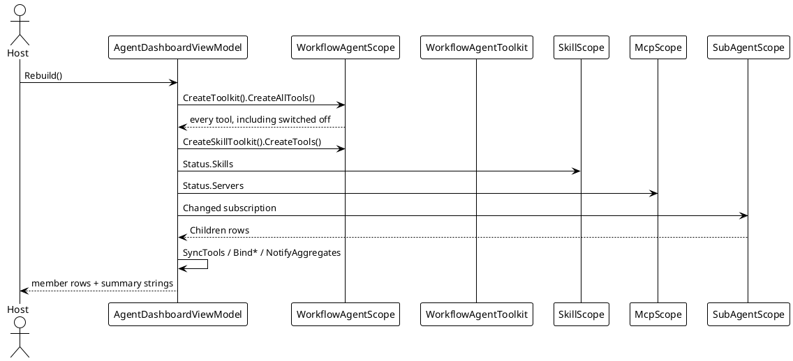
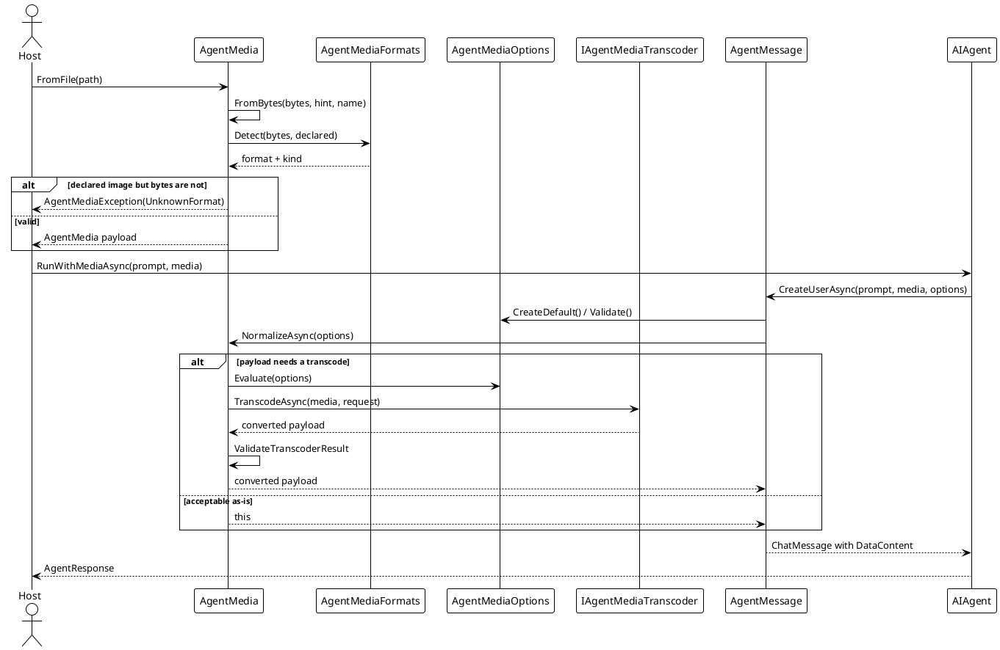

# 智能体仪表盘与转录

本页追踪智能体运行的观察面：一次运行的事件如何沿管线进入转录、仪表盘如何重建成员行，以及媒体载荷在成为用户消息一部分之前如何被校验。

管线是库自己的层，通过 `UseAgentPipeline` / `WithPipeline` 组合到 Microsoft Agent Framework 的中间件槽位。

## 事件管线

`AgentPipelineAgent` 位于中间件槽位，发布回合边界与内容，并原样交出内层流。它从不消费或缓冲它观察到的更新。

Source: `Src/Core/VeloxDev.Core.Extension/Agent/Pipelines/AgentPipelineAgent.cs:77-131`

```csharp
protected override async IAsyncEnumerable<AgentResponseUpdate> RunCoreStreamingAsync(
    IEnumerable<ChatMessage> messages,
    AgentSession? session = null,
    AgentRunOptions? options = null,
    [EnumeratorCancellation] CancellationToken cancellationToken = default)
{
    var request = messages as IReadOnlyList<ChatMessage> ?? [.. messages];
    var (prompt, attachments) = LastUserMessage(request);
    var started = Stopwatch.StartNew();
    await PublishAsync(new AgentTurnStarted(AgentRunKind.Streaming, prompt, attachments), cancellationToken).ConfigureAwait(false);

    await using var updates = base.RunCoreStreamingAsync(request, session, options, cancellationToken).GetAsyncEnumerator(cancellationToken);
    while (await updates.MoveNextAsync().ConfigureAwait(false))
    {
        await PublishContentsAsync(updates.Current.Contents, cancellationToken).ConfigureAwait(false);
        yield return updates.Current;
    }
}
```

阶段按添加顺序运行。作用域先组合文本、再工具、再记账、再 token 用量；文本阶段必须在工具阶段关闭开启条目之前看到工具调用事件。

Source: `Src/Core/VeloxDev.Core.Extension/Agent/Workflow/WorkflowAgentScope.cs:1755-1758`

```csharp
pipeline.Use(new TextPipeline(() => _transcript, () => UIContext));
pipeline.Use(SharedTools);
pipeline.Use(CreateToolkit().CreateAccountingStage());
pipeline.Use(new TokenUsageStage(this));
```

一个阶段出错不会中断运行。每个阶段被隔离；抛异常会跳过链的其余部分并在 `StageFailed` 上报。

Source: `Src/Core/VeloxDev.Core.Extension/Agent/Pipelines/AgentPipeline.cs:84-107`

```csharp
public ValueTask PublishAsync(AgentEvent agentEvent, CancellationToken cancellationToken = default)
    => InvokeAsync(0, agentEvent ?? throw new ArgumentNullException(nameof(agentEvent)), cancellationToken);

private async ValueTask InvokeAsync(int index, AgentEvent agentEvent, CancellationToken cancellationToken)
{
    if (index >= _stages.Count) return;
    var stage = _stages[index];
    try
    {
        await stage.OnEventAsync(agentEvent, next => InvokeAsync(index + 1, next, cancellationToken), cancellationToken).ConfigureAwait(false);
    }
    catch (Exception ex)
    {
        StageFailed?.Invoke(this, new AgentStageFailedEventArgs(stage, agentEvent, ex));
    }
}
```



## 转录装配

文本增量被缓冲，在阈值或回合边界刷新。角色是键的一部分：从推理切到回答会刷新待处理片段，因此工具调用不会落在半截回答下面。

Source: `Src/Core/VeloxDev.Core.Extension/Agent/Pipelines/TextPipeline.cs:135-171`

```csharp
private async ValueTask BufferAsync(
    SynchronizationContext? context, AgentTranscript transcript, string fragment, bool reasoning)
{
    if (string.IsNullOrEmpty(fragment)) return;

    if (_hasPending && _pendingIsReasoning != reasoning)
    {
        await DeliverAsync(context, transcript).ConfigureAwait(false);
        _deliveredSinceBoundary = false;
    }

    _pendingIsReasoning = reasoning;
    _hasPending = true;
    _pending.Append(fragment);

    if (!_deliveredSinceBoundary || _pending.Length >= FlushThreshold)
        await DeliverAsync(context, transcript).ConfigureAwait(false);
}
```

工具调用在添加自身之前关闭任何开启条目。这让转录按顺序阅读，而不是把工具调用嵌进未完成的回答里。

Source: `Src/Core/VeloxDev.Core.Extension/Agent/Pipelines/AgentTranscript.cs:395-422`

```csharp
public AgentTranscriptEntry AddToolCall(string toolName, string result, AgentToolOutcome outcome)
{
    var entry = AgentTranscriptEntry.ToolCall(toolName, result, outcome);
    Close(entry);
    return entry;
}

private AgentTranscriptEntry Append(AgentTranscriptRole role, string fragment)
{
    if (Open is null || Open.Role != role || !Open.IsStreaming)
    {
        Open = role == AgentTranscriptRole.Assistant
            ? AgentTranscriptEntry.Assistant()
            : AgentTranscriptEntry.Reasoning();
        Entries.Add(Open);
    }

    Open.Append(fragment);
    return Open;
}
```

`ToMarkdown` 把连续的工具调用收进一个块；开启 chat fence 时则各折成一个面板。转录可通过 `ToJson` / `Restore` 往返。

## 仪表盘重建

`AgentDashboardViewModel` 不拥有状态，它镜像作用域的子系统。`Rebuild` 重读工具、技能、MCP 服务器与子智能体，然后重算聚合字符串。

Source: `Src/Core/VeloxDev.Core.Extension/Agent/Dashboard/AgentDashboardViewModel.cs:172-203`

```csharp
public void Rebuild()
{
    RebuildSystemTools();
    RebuildSkillTools();
    BindSkills();
    BindMcp();
    RebuildSkills();
    RebuildMcpServers();
    RebuildSubAgents();
    NotifyAggregates();
}

private void RebuildSubAgents()
{
    var source = _scope.SubAgents;
    if (!ReferenceEquals(source, _boundSubAgents))
    {
        if (_boundSubAgents is not null) _boundSubAgents.Changed -= OnSubAgentsChanged;
        _boundSubAgents = source;
        if (source is not null) source.Changed += OnSubAgentsChanged;
    }

    SubAgents.Clear();
    if (source is null) return;
    foreach (var row in source.Children) SubAgents.Add(row);
}
```

它枚举 `CreateAllTools` 而不是 `CreateTools`，因此被关闭的工具仍有行并能重新打开。闸门说明解释那些已注册但在调用时拒绝的工具（例如未开启 `WithAllowNodeExecution` 的执行工具）。



## 媒体校验

`AgentMedia` 在任何请求发出之前校验字节。声明的媒体类型是提示，字节说了算。声明为图片但头部不是已识别图片的载荷，在构造时就被拒绝。

Source: `Src/Core/VeloxDev.Core.Extension/Agent/Media/AgentMedia.cs:96-127`

```csharp
public static AgentMedia FromBytes(ReadOnlyMemory<byte> bytes, string? mediaType = null, string? name = null)
{
    if (bytes.IsEmpty) throw new AgentMediaException(AgentMediaError.Empty, ...);

    var copy = bytes.ToArray();
    var declared = AgentMediaFormats.CanonicalMediaType(mediaType);
    var declaredKind = AgentMediaFormats.KindOfMediaType(declared);
    var descriptor = AgentMediaFormats.Detect(copy, declared);

    if (declaredKind == AgentMediaKind.Image && descriptor.Kind != AgentMediaKind.Image)
        throw new AgentMediaException(AgentMediaError.UnknownFormat, ...);

    var width = 0;
    var height = 0;
    if (descriptor.Kind == AgentMediaKind.Image)
        ImageHeaderReader.TryRead(copy, descriptor.Format, out width, out height);

    return new AgentMedia(copy, descriptor.Format, descriptor.Kind, descriptor.MediaType, name,
        declared, width > 0 ? width : null, height > 0 ? height : null);
}
```

`Normalize` 与 `NormalizeAsync` 应用限制；当载荷必须改变时调用配置的 `IAgentMediaTranscoder`。`Normalize` 在需要转码但只配置了异步转码器时拒绝；`NormalizeAsync` 执行转码。

Source: `Src/Core/VeloxDev.Core.Extension/Agent/Media/AgentMedia.cs:297-337`

```csharp
public async Task<AgentMedia> NormalizeAsync(
    AgentMediaOptions? options = null, CancellationToken cancellationToken = default)
{
    options ??= AgentMediaOptions.CreateDefault();
    options.Validate();
    ValidateDeclaredMediaType(options);

    var decision = Evaluate(options);
    if (!decision.NeedsTranscode) return this;

    var transcoder = options.Transcoder;
    if (transcoder is null) throw Reject(decision.Reason, options);

    var target = ChooseTarget(decision.Reason, options);
    var request = new AgentMediaTranscodeRequest(...);
    var converted = await transcoder.TranscodeAsync(this, request, cancellationToken).ConfigureAwait(false);
    // ...
    return converted;
}
```



Source: `Src/Core/VeloxDev.Core.Extension/Agent/Media/AgentMessage.cs:93-110`

```csharp
public static async Task<ChatMessage> CreateUserAsync(
    string? text, IEnumerable<AgentMedia>? media, AgentMediaOptions? options = null,
    CancellationToken cancellationToken = default)
{
    var validated = new List<IAgentMediaContent>();
    if (media is not null)
        foreach (var item in media)
        {
            if (item is null) continue;
            validated.Add(await item.NormalizeAsync(options, cancellationToken).ConfigureAwait(false));
        }
    return User(text, validated);
}
```

## 相关

- [工作流智能体工具](../17_工作流智能体工具/index.md) —— 这些事件所报告的工具调用。
- [智能体安全与预算](../18_智能体安全与预算/index.md) —— 管线运行的记账阶段。
- [子智能体](../21_子智能体/index.md) —— 仪表盘镜像的名册。
- [无头 CLI](../23_无头CLI/index.md) —— 没有仪表盘的同一执行路径。
