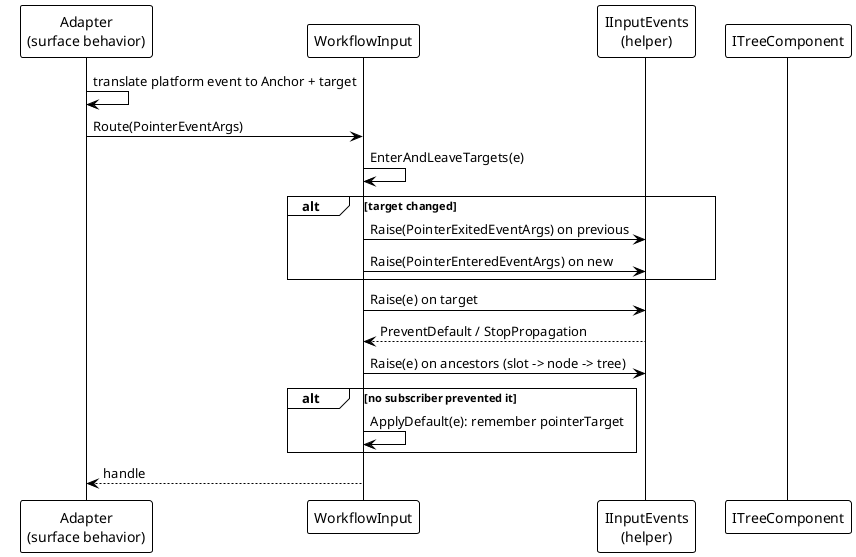
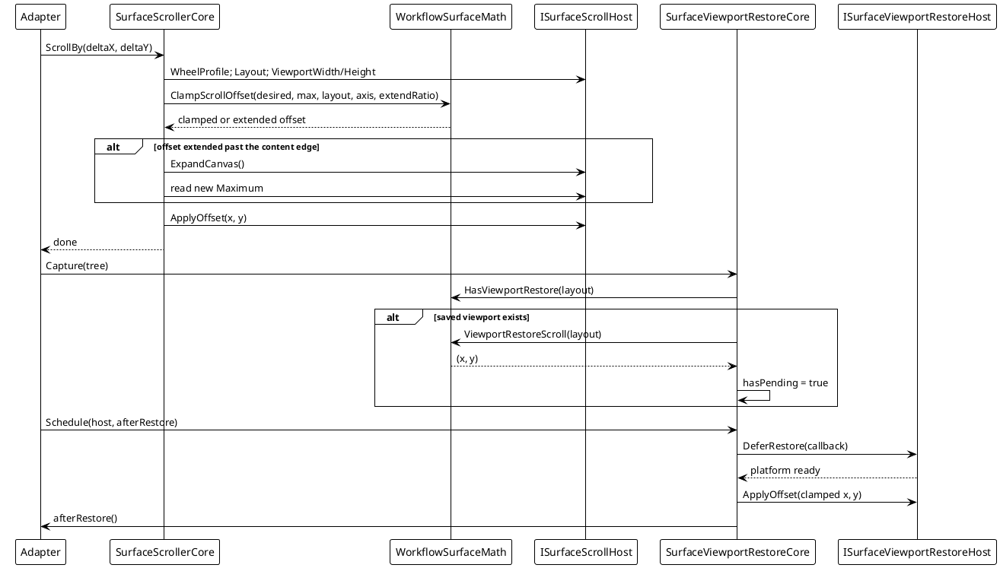
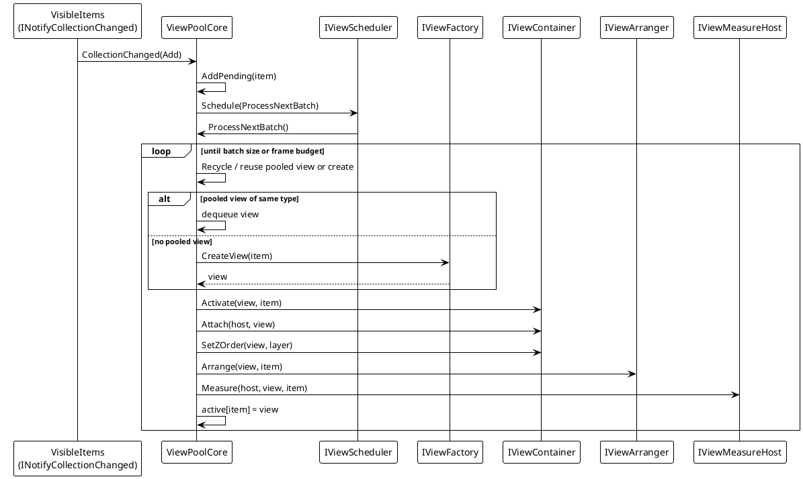

# 平台适配器契约

本页追踪每个 GUI 适配器共同闭合的共享表面：输入路由、滚动与视口恢复核心、视图池管线。七家适配器观察平台的方式不同；它们调用的契约在这里。

## 输入路由

`WorkflowInput` 每棵树一个实例。适配器用平台翻译后的事件调用 `Route`；Core 解析目标、向指针变化的两端发送 enter/leave、从目标到祖先冒泡，然后应用自己的默认动作。

Source: `Src/Core/VeloxDev.Core/WorkflowSystem/GUI/Events/WorkflowInput.cs:267-289`

```csharp
public void Route(PointerEventArgs e)
{
    if (e is null) throw new ArgumentNullException(nameof(e));

    EnterAndLeaveTargets(e);

    if (Bubble(e)) return;

    ApplyDefault(e);
}

public void Route(KeyEventArgs e)
{
    if (e is null) throw new ArgumentNullException(nameof(e));
    Bubble(e);
}
```

冒泡是目标先看，再逐级上溯，树永远最后。实现 `IInputEvents` 的 helper 在 `InputRelay` 上收到事件；`PreventDefault` 抑制框架自己的默认动作，`StopPropagation` 截断链的其余部分。

Source: `Src/Core/VeloxDev.Core/WorkflowSystem/GUI/Events/WorkflowInput.cs:319-378`

```csharp
private bool Bubble(PointerEventArgs e)
{
    var prevented = false;

    foreach (var helper in Chain(e.Target))
    {
        if (helper is not IInputEvents events) continue;

        events.Input.Raise(e);

        if (e.Handle.PreventDefault) prevented = true;
        if (e.Handle.StopPropagation) break;
    }

    return prevented;
}

private IEnumerable<IWorkflowHelper> Chain(IWorkflowComponent? target)
{
    switch (target)
    {
        case ISlotComponent slot:
            yield return slot.GetHelper();
            if (slot.Parent is { } owner) yield return owner.GetHelper();
            break;
        case INodeComponent node: yield return node.GetHelper(); break;
        case ILinkComponent link: yield return link.GetHelper(); break;
    }
    yield return tree.GetHelper();
}
```

指针事件唯一的框架默认动作是记住指针在哪。该目标就是悬停、删除与七家适配器键盘路由所读的东西。

Source: `Src/Core/VeloxDev.Core/WorkflowSystem/GUI/Events/WorkflowInput.cs:383-388`

```csharp
private void ApplyDefault(PointerEventArgs e)
{
    if (IsSuspended) return;
    pointerTarget = e is PointerExitedEventArgs ? null : e.Target;
}
```



## 滚动与视口恢复

`SurfaceScrollerCore` 实现 `IWorkflowSurfaceScroller` 与 `IWorkflowSurfaceNavigator`。它把滚轮增量换成步长，再经 `WorkflowSurfaceMath` 夹取；越过内容边缘的过量会撑大画布，而不是在边缘停住。

Source: `Src/Core/VeloxDev.Core/WorkflowSystem/GUI/Surface/SurfaceScrollerCore.cs:49-116`

```csharp
public void ScrollBy(double wheelDeltaX, double wheelDeltaY)
{
    // ... resolve step from SurfaceWheelProfile ...
    var desiredX = dx != 0d ? offsetX + dx : offsetX;
    var desiredY = dy != 0d ? offsetY + dy : offsetY;

    if (layout is null)
    {
        host.ApplyOffset(
            dx != 0d ? WorkflowSurfaceMath.ClampValue(desiredX, 0d, maxX) : null,
            dy != 0d ? WorkflowSurfaceMath.ClampValue(desiredY, 0d, maxY) : null);
        return;
    }

    var newX = dx != 0d
        ? WorkflowSurfaceMath.ClampScrollOffset(desiredX, maxX, layout, horizontal: true,
            extendRatio: WorkflowSurfaceMath.DefaultPanExtendRatio)
        : desiredX;
    // ...
    host.ApplyOffset(/* clamped offsets */);
}
```

`SurfaceViewportRestoreCore` 在绑定树变化时捕获其保存的视口，再通过适配器延迟一次恢复。若恢复在平台解析出滚动容器之前运行，位置会保持待处理，等下一次表面刷新。

Source: `Src/Core/VeloxDev.Core/WorkflowSystem/GUI/Surface/SurfaceViewportRestoreCore.cs:39-95`

```csharp
public void Capture(ITreeComponent? tree)
{
    if (tree is null || ReferenceEquals(tree, lastTree)) return;

    lastTree = tree;
    hasPending = false;

    if (!WorkflowSurfaceMath.HasViewportRestore(tree.Layout)) return;

    var scroll = WorkflowSurfaceMath.ViewportRestoreScroll(tree.Layout);
    pendingX = scroll.Horizontal;
    pendingY = scroll.Vertical;
    hasPending = true;
}

public void Schedule(ISurfaceViewportRestoreHost host, Action? afterRestore = null)
{
    if (!hasPending || isQueued) return;
    isQueued = true;
    host.DeferRestore(() =>
    {
        isQueued = false;
        if (!hasPending || !host.IsRestoreEnabled) return;
        hasPending = false;
        host.ApplyOffset(/* clamped pendingX/pendingY */);
        afterRestore?.Invoke();
    });
}
```



## 视图池管线

`ViewPoolCore` 跟踪可见项集合。集合变化播种待处理队列；宿主调度器按批大小与帧预算运行批次；`Materialize` 复用同运行时类型的池化视图，或经工厂创建，再激活、挂载、分层、排列、测量。

Source: `Src/Core/VeloxDev.Core/WorkflowSystem/ViewHosting/ViewPool.cs:274-317`, `319-378`

```csharp
private void ProcessNextBatch()
{
    scheduled = false;
    if (disposed) return;

    var processed = 0;
    var batchSize = Math.Max(1, host.PoolPolicy.BatchSize);
    var budgetMilliseconds = host.PoolPolicy.FrameBudgetMilliseconds;
    var started = Stopwatch.GetTimestamp();

    while (processed < batchSize && pending.Count > 0)
    {
        var item = pending.Dequeue();
        if (!pendingSet.Remove(item)) continue;
        Materialize(item);
        processed++;
        if (budgetTicks > 0L && Stopwatch.GetTimestamp() - started >= budgetTicks) break;
    }

    if (pendingSet.Count > 0) ScheduleNextBatch();
}
```

```csharp
private void Materialize(object item)
{
    // ... reject unsupported types and link-layer items ...
    if (pools.TryGetValue(itemType, out var pool) && pool.Count > 0)
    {
        view = pool.Dequeue();
        reusedViewCount++;
    }

    if (view is null)
    {
        view = host.Factory.CreateView(typedItem);
        if (view is null) { unsupportedTypes.Add(itemType); return; }
        createdViewCount++;
    }

    host.Container.Activate(view, typedItem);
    host.Container.Attach(hostElement, view);
    host.Container.SetZOrder(view, host.LayerPolicy.GetZOrder(typedItem));
    host.Arranger.Arrange(view, typedItem);
    host.MeasureHost.Measure(hostElement, view, typedItem);
    active[item] = view;
}
```



`ViewSourcePipelineCore` 组合平台层（factory、container、arranger、scheduler、diagnostics），并在给定来源上创建池。适配器的 `ViewPool` 附加属性在来源或模板选择器变化时重建该管线，并处置旧管线。

Source: `Src/Core/VeloxDev.Core/WorkflowSystem/ViewHosting/ViewSourcePipelineCore.cs:56-88`

```csharp
public ViewSourcePipelineCore(
    THost hostElement, TFactory factory, TContainer container, TArranger arranger,
    TScheduler scheduler, TDiagnostics diagnostics, INotifyCollectionChanged source,
    IViewPoolPolicy? poolPolicy = null, IViewLayerPolicy<TItem>? layerPolicy = null,
    IViewLinkLayer<THost, TItem>? linkLayer = null, IViewMeasureHost<THost, TView, TItem>? measureHost = null)
    : base(factory, container, arranger, scheduler, diagnostics, poolPolicy, layerPolicy, linkLayer, measureHost)
{
    Pool = new ViewPool<THost, TView, TItem, TPriorityCore>(hostElement, this, source);
}
```

## 覆盖层测量

`SurfaceMetrics` 是适配器从其滚动容器与装饰器算出的共享快照。`SurfaceMetricsPush` 把它推给网格装饰器、小地图覆盖层与树的虚拟化内缩，于是同一套减法不必每家重复。

Source: `Src/Core/VeloxDev.Core/WorkflowSystem/GUI/Surface/SurfaceMetricsPush.cs:25-60`

```csharp
public static void PushGrid(
    SurfaceMetrics metrics, IWorkflowGridDecorator decorator, ITreeComponent? tree)
{
    decorator.ScrollOffsetX = metrics.ScrollOffsetX;
    decorator.ScrollOffsetY = metrics.ScrollOffsetY;
    decorator.ContentOffsetX = metrics.ContentOffsetX;
    decorator.ContentOffsetY = metrics.ContentOffsetY;
    tree?.SetVirtualizeInset(left: decorator.RulerBand, top: decorator.RulerBand);
}

public static void PushMinimap(
    SurfaceMetrics metrics, IWorkflowMinimapOverlay minimap, ITreeComponent? tree)
{
    minimap.ScrollOffsetX = metrics.ScrollOffsetX;
    minimap.WorkflowTree = tree;
    minimap.AvailableRight = metrics.Available.Right;
    minimap.AvailableTop = metrics.Available.Top;
    minimap.AvailableBottom = metrics.Available.Bottom;
    minimap.MinimapMargin = metrics.Available.Margin;
}
```

`IWorkflowMinimapOverlay` 继承 `IWorkflowGridDecorator`，因此画小地图的覆盖层也会收到共享偏移推送。

## 相关

- [WPF 适配器](../25_WPF适配器/index.md) —— 闭合此契约的一家平台。
- [Avalonia 适配器](../26_Avalonia适配器/index.md) —— 指针变体。
- [WinUI 适配器](../27_WinUI适配器/index.md) —— 调度队列承载。
- [MAUI 适配器](../28_MAUI适配器/index.md) —— 手势识别器变体。
- [WinForms 适配器](../29_WinForms适配器/index.md) —— 静态附加配置。
- [Razor 适配器](../30_Razor适配器/index.md) —— 组件与 JavaScript 变体。
- [Jalium 适配器](../31_Jalium适配器/index.md) —— 附加属性变体。
