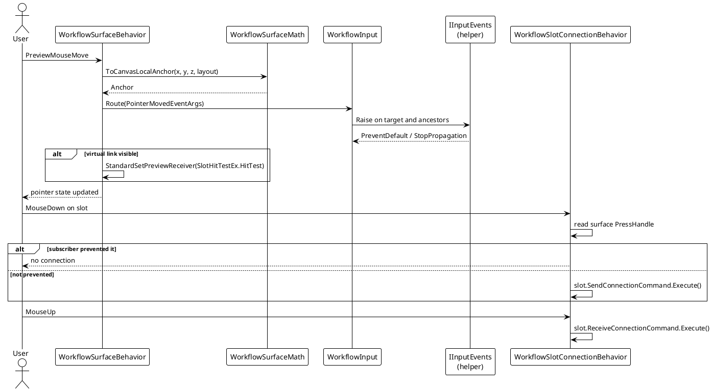
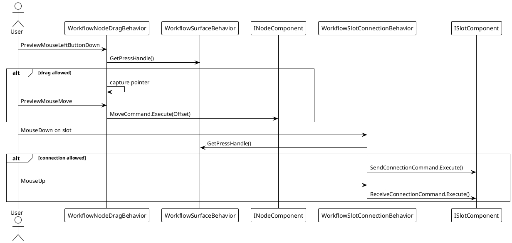

# WPF 适配器

本页追踪 WPF 表面从附加属性激活到 Core 输入路由，然后是与它并行的节点拖动、插槽连接与视图池链路。

适配器是一组挂在 `UserControl`、`Panel`、`FrameworkElement` 上的附加行为。命名部件（`ScrollViewerName`、`CanvasName`、`GridDecoratorName`、`MinimapOverlayName`、`PointerPressSourceName`）解析 Core 不具备平台知识的可视件。

## 挂载表面

`IsEnabled` 是总开关。打开时挂事件处理器、打开 `Focusable` 让悬停焦点与 Delete 有落点、解析命名部件并刷新表面状态。

Source: `Src/Adapters/VeloxDev.WPF/WorkflowSystem/AttachedBehaviors/WorkflowSurfaceBehavior.cs:334-376`

```csharp
private static void OnIsEnabledChanged(DependencyObject d, DependencyPropertyChangedEventArgs e)
{
    if (d is not UserControl control) return;
    if (Equals(e.NewValue, true)) { Attach(control); return; }
    Detach(control);
}

private static void Attach(UserControl control)
{
    Detach(control);

    var state = new SurfaceState { Host = control, Restore = new SurfaceViewportRestoreCore() };
    control.SetValue(StateProperty, state);

    control.Focusable = true;
    control.Loaded += OnLoaded;
    control.Unloaded += OnUnloaded;
    control.DataContextChanged += OnDataContextChanged;
    control.PreviewMouseMove += OnPreviewMouseMove;
    control.PreviewMouseDown += OnLinkPointerPressed;
    control.MouseUp += OnLinkPointerReleased;
    control.MouseEnter += OnLinkPointerEntered;
    control.MouseLeave += OnLinkPointerExited;
    control.PreviewMouseWheel += OnLinkPointerWheel;
    control.KeyDown += OnLinkKeyDown;
    control.KeyUp += OnLinkKeyUp;
    control.AddHandler(UIElement.MouseUpEvent, MouseUpHandler, true);
    ResolveNamedControls(control, state);
    Refresh(control);
}
```

滚轮绑定在*预览*相。被托管的 `ScrollViewer` 是后代，冒泡的滚轮事件在表面看到之前就会被它标成已处理。

## 路由输入

每次指针翻译都落到 `RoutePointer`：把平台点换成画布局部 `Anchor`、解析模型目标、路由一个 Core 事件。

Source: `Src/Adapters/VeloxDev.WPF/WorkflowSystem/AttachedBehaviors/WorkflowSurfaceBehavior.cs:976-988`

```csharp
private static WorkflowEventHandle RoutePointer(
    SurfaceState state, ITreeComponent tree, Point point, FrameworkElement source, DependencyObject? hit,
    Func<Anchor, IWorkflowComponent?, WorkflowEventHandle, Wf.PointerEventArgs> args)
{
    var anchor = WorkflowSurfaceMath.ToCanvasLocalAnchor(point.X, point.Y, Panel.GetZIndex(source), tree.Layout);
    var input = WorkflowInput.For(tree);
    var target = ResolveTarget(hit, tree, anchor.Horizontal, anchor.Vertical, input.HitRadius);

    var handle = new WorkflowEventHandle();
    input.Route(args(anchor, target, handle));
    FocusHoveredLink(input, state);
    return handle;
}
```

`OnPreviewMouseMove` 把指针位置发布给树，虚拟连线可见时更新连接预览，否则路由普通移动。

Source: `Src/Adapters/VeloxDev.WPF/WorkflowSystem/AttachedBehaviors/WorkflowSurfaceBehavior.cs:703-736`

```csharp
private static void OnPreviewMouseMove(object sender, MouseEventArgs e)
{
    // ... guard state and canvas ...
    var point = e.GetPosition(state.Canvas);
    var pointer = WorkflowSurfaceMath.ToCanvasLocalAnchor(point.X, point.Y, 0, viewModel.Layout);
    viewModel.SetPointerCommand.Execute(pointer);

    if (viewModel.VirtualLink.IsVisible)
    {
        viewModel.StandardSetPreviewReceiver(
            SlotHitTestEx.HitTest(viewModel, pointer.Horizontal, pointer.Vertical));
        return;
    }

    RoutePointer(state, viewModel, point, host, e.OriginalSource as DependencyObject,
        (anchor, target, handle) => new Wf.PointerMovedEventArgs(anchor, Modifiers(), host, target, handle));
}
```



## 节点拖动

拖动行为刻意很薄：读取表面已产生的按下句柄、捕获指针、派发自上次移动以来的增量 `MoveCommand`。订阅者可在自己的 relay 上设置 `PreventDefault` 否决拖动。

Source: `Src/Adapters/VeloxDev.WPF/WorkflowSystem/AttachedBehaviors/WorkflowNodeDragBehavior.cs:88-132`

```csharp
private static void OnMouseDown(object sender, MouseButtonEventArgs e)
{
    // ...
    if (WorkflowSurfaceBehavior.GetPressHandle(control)?.PreventDefault == true) return;

    state.IsDragging = true;
    state.LastPosition = e.GetPosition(state.CoordinateHost);
    Mouse.Capture(control);
    e.Handled = true;
}

private static void OnMouseMove(object sender, MouseEventArgs e)
{
    // ...
    var current = e.GetPosition(state.CoordinateHost);
    node.MoveCommand.Execute(new Offset(current.X - state.LastPosition.X, current.Y - state.LastPosition.Y));
    state.LastPosition = current;
    e.Handled = true;
}
```

## 插槽连接

连接行为把按下映射到 `SendConnectionCommand`、松开映射到 `ReceiveConnectionCommand`。它读取表面的按下句柄而不是检查模型，因为插槽不是 `DependencyObject`。

Source: `Src/Adapters/VeloxDev.WPF/WorkflowSystem/AttachedBehaviors/WorkflowSlotConnectionBehavior.cs:39-70`

```csharp
private static void OnPointerPressed(object sender, MouseButtonEventArgs e)
{
    if (sender is not Control { DataContext: ISlotComponent slot } control) return;

    if (WorkflowSurfaceBehavior.GetPressHandle(control)?.PreventDefault == true) return;

    slot.SendConnectionCommand.Execute(null);
    e.Handled = true;
}

private static void OnPointerReleased(object sender, MouseButtonEventArgs e)
{
    if (sender is not Control { DataContext: ISlotComponent slot }) return;

    slot.ReceiveConnectionCommand.Execute(null);
    e.Handled = true;
}
```



## 视图池与小地图

`ViewPool.ItemsSource` / `TemplateSelector` 是挂在 `Panel` 上的附加属性。任一变化都会重建整个 `ViewSourcePipeline`；旧系统被处置并移除，面板不会根住它。

Source: `Src/Adapters/VeloxDev.WPF/WorkflowSystem/AttachedBehaviors/ViewPool.cs:52-98`

```csharp
private static void OnItemsSourceChanged(DependencyObject d, DependencyPropertyChangedEventArgs e)
    => RebuildIfPanel(d);

private static void Rebuild(DependencyObject d)
{
    if (d is not Panel panel) return;
    Cleanup(panel);

    if (GetItemsSource(panel) is not { } source) return;

    var system = new ViewSourcePipeline(panel, GetTemplateSelector(panel), source);
    _systems.Add(panel, system);
    panel.Unloaded += OnPanelUnloaded;
}
```

`WorkflowMinimapOverlay` 在 `FrameworkElement` 上实现 `IWorkflowMinimapOverlay`；表面把 `SurfaceMetrics` 推给它，并监听它的拖拽滚动输入。网格装饰器与小地图拿到相同的 scroll/content 偏移，因此两者画在同一帧里。

## 相关

- [平台适配器契约](../24_平台适配器契约/index.md) —— 本适配器闭合的 Core 表面。
- [Avalonia 适配器](../26_Avalonia适配器/index.md) —— 最接近的兄弟实现。
- [工作流条目模板](../32_工作流条目模板/index.md) —— 与这些行为配套生成的 WPF 视图。
