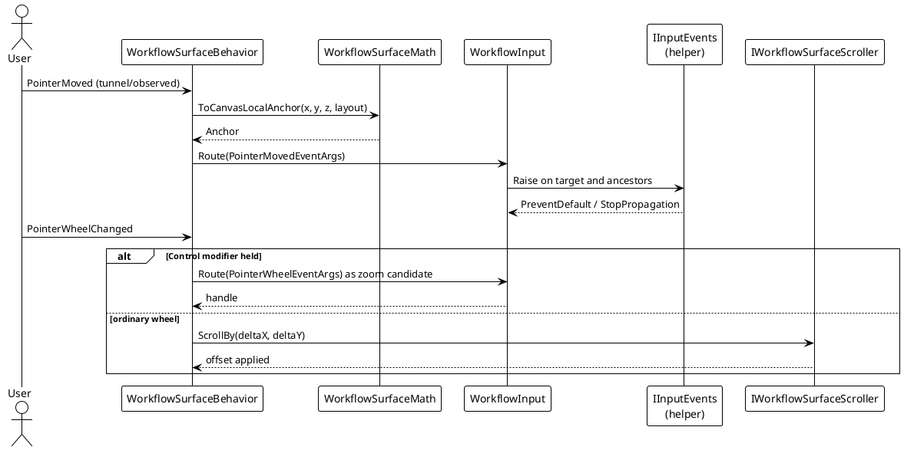
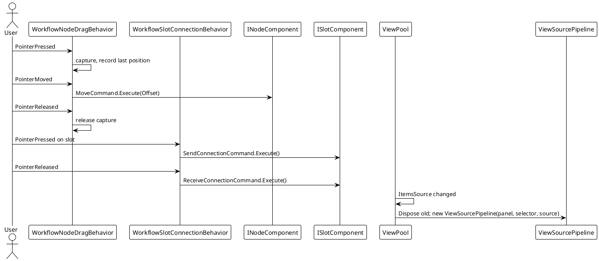

# Avalonia 适配器

本页追踪 Avalonia 表面从 `AvaloniaProperty` 激活到 Core 输入路由，然后是拖动、连接与视图池链路。

Avalonia 使用与 WPF 相同的附加行为分解，但对象模型是 `AvaloniaObject` / `AvaloniaProperty`，且输入走*隧道*相而不是 preview 事件。

## 挂载表面

`IsEnabled` 在隧道相挂处理器、打开 `Focusable`、解析命名部件并刷新。必须用隧道相，因为节点与插槽处理器在视觉树更深处；表面必须在它们读取之前产生按下句柄。

Source: `Src/Adapters/VeloxDev.Avalonia/WorkflowSystem/AttachedBehaviors/WorkflowSurfaceBehavior.cs:445-473`

```csharp
private static void Attach(UserControl control)
{
    Detach(control);

    var state = new SurfaceState { Host = control, Restore = new SurfaceViewportRestoreCore() };
    control.SetValue(StateProperty, state);

    control.Focusable = true;
    control.AttachedToVisualTree += OnAttachedToVisualTree;
    control.DetachedFromVisualTree += OnDetachedFromVisualTree;
    control.DataContextChanged += OnDataContextChanged;
    control.AddHandler(InputElement.PointerPressedEvent, OnPressRoute, RoutingStrategies.Tunnel);
    control.PointerEntered += OnPointerEntered;
    control.PointerMoved += OnPointerMoved;
    control.PointerExited += OnPointerExited;
    control.AddHandler(InputElement.PointerWheelChangedEvent, OnPointerWheel, RoutingStrategies.Tunnel);
    control.PointerReleased += OnPointerReleased;
    control.PointerCaptureLost += OnPointerCaptureLost;
    control.KeyUp += OnKeyUp;
    control.KeyDown += OnKeyDown;
    ResolveNamedControls(control, state);
    Refresh(control);
}
```

## 路由输入

`OnPointerMoved` 与 WPF 流程一致：发布指针、虚拟连线可见时报告候选接收口，否则翻译并路由一个 Core 事件。

Source: `Src/Adapters/VeloxDev.Avalonia/WorkflowSystem/AttachedBehaviors/WorkflowSurfaceBehavior.cs:998-1025`

```csharp
private static void OnPointerMoved(object? sender, PlatformInput.PointerEventArgs e)
{
    // ... guard host, state, canvas ...
    OnCanvasPanMoved(host, state, e);
    if (state.IsPanning) return;

    var point = e.GetPosition(state.Canvas);
    var pointer = WorkflowSurfaceMath.ToCanvasLocalAnchor(point.X, point.Y, 0, viewModel.Layout);
    viewModel.SetPointerCommand.Execute(pointer);

    if (viewModel.VirtualLink is { IsVisible: true })
    {
        viewModel.StandardSetPreviewReceiver(
            SlotHitTestEx.HitTest(viewModel, pointer.Horizontal, pointer.Vertical));
        return;
    }

    RoutePointer(host, state, e,
        (position, target, handle) => new Wf.PointerMovedEventArgs(position, Modifiers(e.KeyModifiers), host, target, handle));
}
```

`RoutePointer` 构建 `WorkflowInput.For(viewModel)` 并调用 `input.Route(args(...))`。滚轮处理器有两项职责：普通滚轮经 `WorkflowInput.Scroller` 滚动表面；Ctrl 滚轮先作为缩放候选路由，让订阅者可以拒绝。



## 节点拖动

只有当表面的按下句柄未被否决时才捕获指针；移动时以增量派发 `MoveCommand`。

Source: `Src/Adapters/VeloxDev.Avalonia/WorkflowSystem/AttachedBehaviors/WorkflowNodeDragBehavior.cs:82-133`

```csharp
private static void OnPointerMoved(object? sender, PlatformInput.PointerEventArgs e)
{
    // ... guard state and coordinate host ...
    var node = ResolveNode(element);
    if (node is null) return;

    var current = e.GetPosition(state.CoordinateHost);
    node.MoveCommand.Execute(new Offset(current.X - state.LastPosition.X, current.Y - state.LastPosition.Y));
    state.LastPosition = current;
}
```

## 插槽连接与视图池

`WorkflowSlotConnectionBehavior` 把按下/松开映射到两条插槽命令，并受表面按下句柄保护。`ViewPool` 为 `ItemsSource` 注册 `AvaloniaProperty` 类处理器，变化时重建管线。

Source: `Src/Adapters/VeloxDev.Avalonia/WorkflowSystem/AttachedBehaviors/WorkflowSlotConnectionBehavior.cs:38-58`

```csharp
private static void OnPointerPressed(object? sender, PlatformInput.PointerPressedEventArgs e)
{
    // ... guard control and slot ...
    slot.SendConnectionCommand.Execute(null);
}

private static void OnPointerReleased(object? sender, PlatformInput.PointerReleasedEventArgs e)
{
    slot.ReceiveConnectionCommand.Execute(null);
}
```

```csharp
ItemsSourceProperty.Changed.AddClassHandler<Panel>(OnItemsSourceChanged);
```



小地图是 `WorkflowMinimapOverlay : Control, IWorkflowMinimapOverlay, ICustomHitTest`；表面把共享 `SurfaceMetrics` 推给它，并通过 `SurfaceViewportRestoreCore` 驱动恢复。

## 相关

- [平台适配器契约](../24_平台适配器契约/index.md) —— 本适配器闭合的 Core 表面。
- [WPF 适配器](../25_WPF适配器/index.md) —— 兄弟 XAML 实现。
- [工作流条目模板](../32_工作流条目模板/index.md) —— 生成的 Avalonia 视图。
