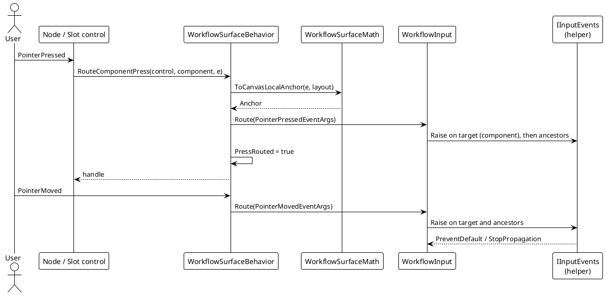
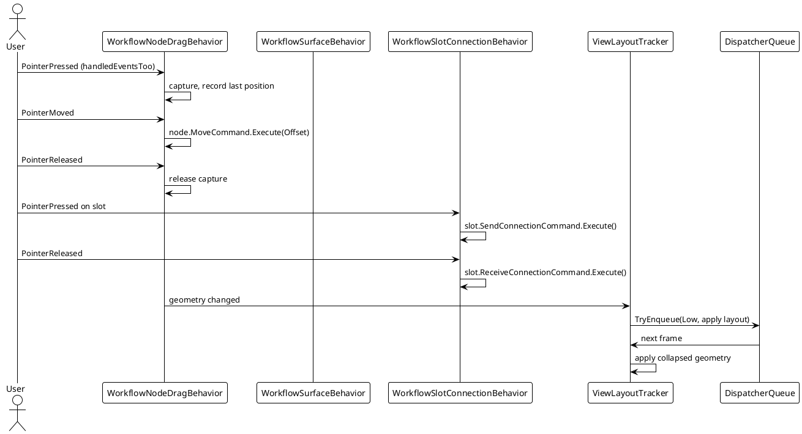

# WinUI 适配器

本页追踪 WinUI 表面从附加属性激活到 Core 输入路由，然后是拖动、连接与延迟布局链路。

WinUI 没有 preview/tunnel 相。表面用 `handledEventsToo` 订阅，因此仍能看到已被后代 `ScrollViewer` 标为已处理的指针事件。

## 挂载表面

`IsEnabled` 挂处理器、解析命名部件并刷新。焦点放在滚动容器而不是宿主，因为宿主的第一个可聚焦后代常是节点卡里的 `TextBox`，聚焦宿主会让 `BringIntoView` 把视口拽回那个输入框。

Source: `Src/Adapters/VeloxDev.WinUI/WorkflowSystem/AttachedBehaviors/WorkflowSurfaceBehavior.cs:369-413`

```csharp
private static void Attach(UserControl control)
{
    Detach(control);

    var state = new SurfaceState { Restore = new SurfaceViewportRestoreCore() };
    control.SetValue(StateProperty, state);

    control.Loaded += OnLoaded;
    control.Unloaded += OnUnloaded;
    control.DataContextChanged += OnDataContextChanged;
    control.PointerMoved += OnPointerMoved;
    control.PointerEntered += OnPointerEntered;
    control.PointerExited += OnPointerExited;
    control.AddHandler(UIElement.PointerReleasedEvent, new PointerEventHandler(OnPointerReleased), true);
    control.AddHandler(UIElement.PointerPressedEvent, new PointerEventHandler(OnLinkPointerPressed), true);
    control.AddHandler(UIElement.KeyDownEvent, new KeyEventHandler(OnLinkKeyDown), false);
    control.AddHandler(UIElement.KeyUpEvent, new KeyEventHandler(OnLinkKeyUp), false);
    ResolveNamedControls(control, state);
    Refresh(control);
}
```

## 路由输入

`RoutePointer` 把平台事件换成画布局部 `Anchor`、解析目标并路由一个 Core 事件。它还负责在指针悬停到连线上时把焦点收给滚动容器，使 Delete 不必点击就能到达表面。

Source: `Src/Adapters/VeloxDev.WinUI/WorkflowSystem/AttachedBehaviors/WorkflowSurfaceBehavior.cs:1167-1187`

```csharp
private static WorkflowEventHandle RoutePointer(
    SurfaceState state, ITreeComponent tree, PointerRoutedEventArgs e, UserControl host,
    DependencyObject? hit,
    Func<Anchor, IWorkflowComponent?, WorkflowEventHandle, Wf.PointerEventArgs> args)
{
    var anchor = ToCanvasLocalAnchor(state, e, tree.Layout);
    var input = WorkflowInput.For(tree);
    var target = ResolveTarget(hit, tree, anchor.Horizontal, anchor.Vertical, input.HitRadius);

    var handle = new WorkflowEventHandle();
    input.Route(args(anchor, target, handle));

    if (input.HoveredLink is not null)
        state.ScrollViewer?.Focus(FocusState.Pointer);

    return handle;
}
```

由于后代在冒泡相先于表面运行，节点或插槽把自己的按下经由 `RouteComponentPress` 送回，并把该笔标记为已路由，避免表面的平移与连线处理器重复路由同一个物理按下。

Source: `Src/Adapters/VeloxDev.WinUI/WorkflowSystem/AttachedBehaviors/WorkflowSurfaceBehavior.cs:1192-1209`

```csharp
internal static WorkflowEventHandle? RouteComponentPress(
    DependencyObject? control, IWorkflowComponent component, PointerRoutedEventArgs e)
{
    // ... resolve host, tree, scroll viewer ...
    var anchor = ToCanvasLocalAnchor(state, e, tree.Layout);
    var handle = new WorkflowEventHandle();
    WorkflowInput.For(tree).Route(new Wf.PointerPressedEventArgs(
        anchor, Modifiers(e.KeyModifiers), host, component, CurrentButton(e, host), 1, handle));

    state.PressRouted = true;
    return handle;
}
```



## 节点拖动与插槽连接

按下捕获指针；移动时以上次移动以来的增量派发 `MoveCommand`。插槽行为把按下映射到发送、松开映射到接收。

Source: `Src/Adapters/VeloxDev.WinUI/WorkflowSystem/AttachedBehaviors/WorkflowNodeDragBehavior.cs:155-172`

```csharp
private static void OnPointerMoved(object sender, PointerRoutedEventArgs e)
{
    // ... guard state and coordinate host ...
    var node = ResolveNode(element);
    if (node is null) return;

    var current = e.GetPosition(state.CoordinateHost);
    node.MoveCommand.Execute(new Offset(current.X - state.LastPosition.X, current.Y - state.LastPosition.Y));
    state.LastPosition = current;
}
```

Source: `Src/Adapters/VeloxDev.WinUI/WorkflowSystem/AttachedBehaviors/WorkflowSlotConnectionBehavior.cs:37-65`

```csharp
private static void OnPointerPressed(object sender, PointerRoutedEventArgs e)
{
    // ... guard control and slot ...
    slot.SendConnectionCommand.Execute(null);
}

private static void OnPointerReleased(object sender, PointerRoutedEventArgs e)
{
    slot.ReceiveConnectionCommand.Execute(null);
}
```

## 延迟布局

节点几何变化经 `ViewLayoutTracker` 应用，它以 `DispatcherQueuePriority.Low` 入队。变更期间同步读取布局会看到折叠前的旧尺寸；延迟的一趟才看到稳定后的尺寸。

Source: `Src/Adapters/VeloxDev.WinUI/WorkflowSystem/ViewHosting/ViewLayoutTracker.cs:35-43`

```csharp
var dispatcher = view.DispatcherQueue;
// ...
dispatcher.TryEnqueue(DispatcherQueuePriority.Low, () =>
{
    // ... apply geometry after the current frame settles ...
});
```



小地图是 `WorkflowMinimapOverlay : Canvas, IWorkflowMinimapOverlay`；其刷新计时器跑在 `DispatcherQueue` 上，重绘以 `Low` 优先级入队，因此不与输入争抢。

## 相关

- [平台适配器契约](../24_平台适配器契约/index.md) —— 本适配器闭合的 Core 表面。
- [WPF 适配器](../25_WPF适配器/index.md) —— 预览相等价物。
- [MAUI 适配器](../28_MAUI适配器/index.md) —— 手势识别器等价物。
- [工作流条目模板](../32_工作流条目模板/index.md) —— 生成的 WinUI 视图。
