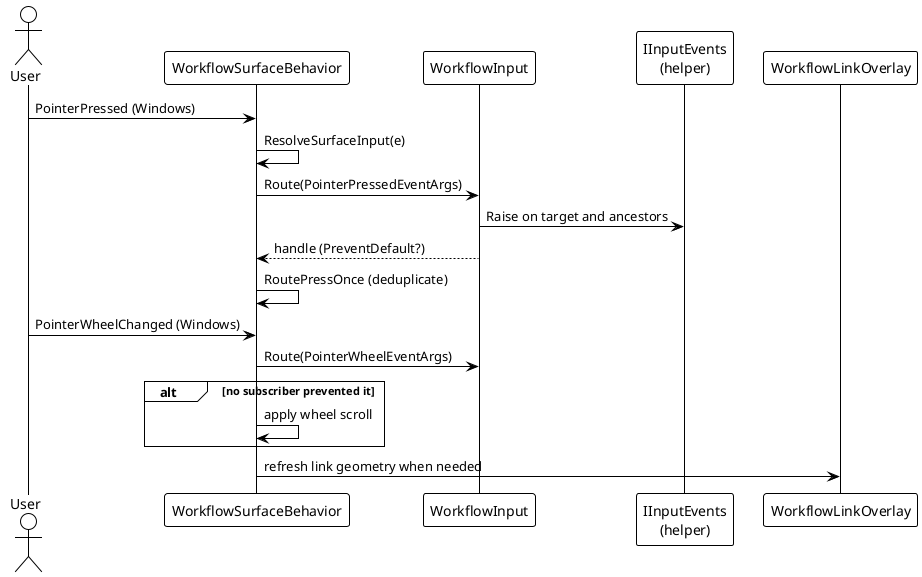
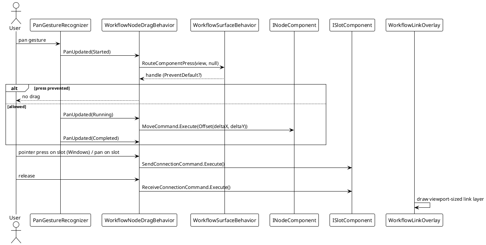
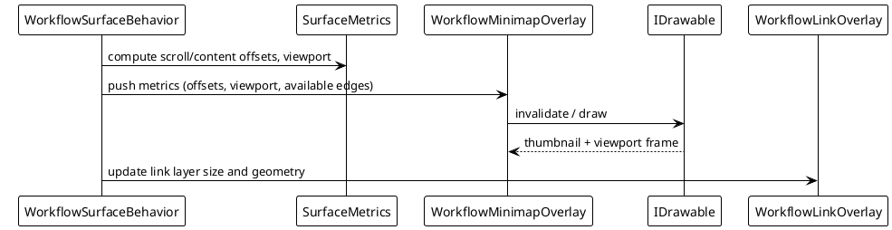

# MAUI 适配器

本页追踪 MAUI 表面从 `BindableProperty` 激活到 Core 输入路由，然后是它使用的两种输入模型：Windows 上的原生指针事件，以及其他平台上的 `PanGestureRecognizer` / `PinchGestureRecognizer`。

MAUI 没有统一的跨平台指针事件。适配器因此分岔：Windows 经平台 `PointerRoutedEventArgs` 路由，其他头部经 pan/pinch 手势并翻译成同样的 Core 事件。

## 挂载表面

`IsEnabled` 挂载加载、卸载、绑定上下文与尺寸处理器，解析命名部件、订阅布局、捕获视口恢复并刷新。

Source: `Src/Adapters/VeloxDev.MAUI/WorkflowSystem/AttachedBehaviors/WorkflowSurfaceBehavior.cs:637-671`

```csharp
private static void Attach(ContentView control)
{
    Detach(control);

    var state = new SurfaceState
    {
        Host = control,
        Restore = new SurfaceViewportRestoreCore(),
    };
    control.SetValue(StateProperty, state);
    control.Loaded += OnLoaded;
    control.Unloaded += OnUnloaded;
    control.BindingContextChanged += OnBindingContextChanged;
    control.SizeChanged += OnHostSizeChanged;
    ResolveNamedControls(control, state);
    UpdateLayoutSubscription(control, state);
    CaptureViewportRestore(control, state);
    Refresh(control);
}
```

## Windows：原生指针事件

在 Windows 上，表面在 `#if WINDOWS` 块内经 `WorkflowInput` 路由自己的按下与滚轮。画布与连线层共享这些路由，因此一次按下或滚轮不会被翻译两次。

Source: `Src/Adapters/VeloxDev.MAUI/WorkflowSystem/AttachedBehaviors/WorkflowSurfaceBehavior.cs:1860-1899`

```csharp
private static WorkflowEventHandle? RouteSurfacePress(
    SurfaceState state, Microsoft.UI.Xaml.Input.PointerRoutedEventArgs e)
{
    if (ResolveSurfaceInput(state, e) is not { } input) return null;

    return RoutePressOnce(input.Tree, () =>
    {
        var routed = WorkflowInput.For(input.Tree);
        var handle = new WorkflowEventHandle();
        routed.Route(new Wf.PointerPressedEventArgs(
            new Anchor(input.Point.X, input.Point.Y, 0), Modifiers(e.KeyModifiers), input.Canvas,
            ResolveTarget(null, input.Tree, input.Point, routed.HitRadius),
            Wf.MouseButton.Left, 1, handle));
        return handle;
    });
}
```

```csharp
private static WorkflowEventHandle? RouteSurfaceWheel(
    SurfaceState state, Microsoft.UI.Xaml.Input.PointerRoutedEventArgs e, double deltaX, double deltaY)
{
    if (ResolveSurfaceInput(state, e) is not { } input) return null;

    return RouteWheelOnce(e, () =>
    {
        var routed = WorkflowInput.For(input.Tree);
        var handle = new WorkflowEventHandle();
        routed.Route(new Wf.PointerWheelEventArgs(
            new Anchor(input.Point.X, input.Point.Y, 0), Modifiers(e.KeyModifiers), input.Canvas,
            ResolveTarget(null, input.Tree, input.Point, routed.HitRadius),
            deltaX, deltaY, handle));
        return handle;
    });
}
```



## 其他头部：手势识别器

非 Windows 上拖动行为没有可用的按下事件，所以 `PanUpdated` 是手势的第一个点。`Started` 转发一次组件按下让订阅者可以否决拖动；`Running` 把 `TotalX` / `TotalY` 累加进 `MoveCommand`。

Source: `Src/Adapters/VeloxDev.MAUI/WorkflowSystem/AttachedBehaviors/WorkflowNodeDragBehavior.cs:299-345`

```csharp
private static void OnPanUpdated(object? sender, PanUpdatedEventArgs e)
{
    // ... guard view and state ...
    switch (e.StatusType)
    {
        case GestureStatus.Started:
            state.CoordinateHost ??= ResolveCoordinateHost(view);
            state.LastPanX = 0d;
            state.LastPanY = 0d;
            state.IsPressPrevented =
                WorkflowSurfaceBehavior.RouteComponentPress(view, null)?.PreventDefault == true;
            state.IsDragging = !state.IsPressPrevented;
            break;
        case GestureStatus.Running:
            if (state.IsPressPrevented) break;
            // ... resolve node ...
            var deltaX = e.TotalX - state.LastPanX;
            var deltaY = e.TotalY - state.LastPanY;
            // ... node.MoveCommand.Execute(new Offset(deltaX, deltaY)) ...
            break;
    }
}
```

表面自身使用 `PanGestureRecognizer` 与 `PinchGestureRecognizer`；捏合被翻译成缩放候选，在平台改变比例之前路由。



## 连线层与小地图

`WorkflowLinkOverlay` 是视口大小的连线层：连线画在节点之上，但不作为独立可视对象参与命中测试。小地图是 `WorkflowMinimapOverlay : Grid, IDrawable, IWorkflowMinimapOverlay`，经 MAUI 的 `IDrawable` 管线绘制，同时仍接收共享 `SurfaceMetrics` 推送。

Source: `Src/Adapters/VeloxDev.MAUI/WorkflowSystem/AttachedBehaviors/WorkflowMinimapOverlay.cs:27`

```csharp
public class WorkflowMinimapOverlay : Grid, IDrawable, IWorkflowMinimapOverlay
```



## 相关

- [平台适配器契约](../24_平台适配器契约/index.md) —— 本适配器闭合的 Core 表面。
- [WinUI 适配器](../27_WinUI适配器/index.md) —— 另一个原生指针头部。
- [工作流条目模板](../32_工作流条目模板/index.md) —— 生成的 MAUI 视图。
