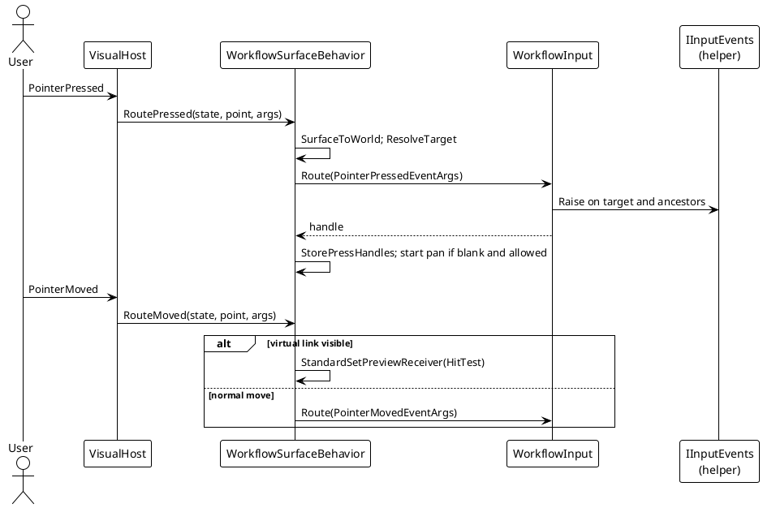
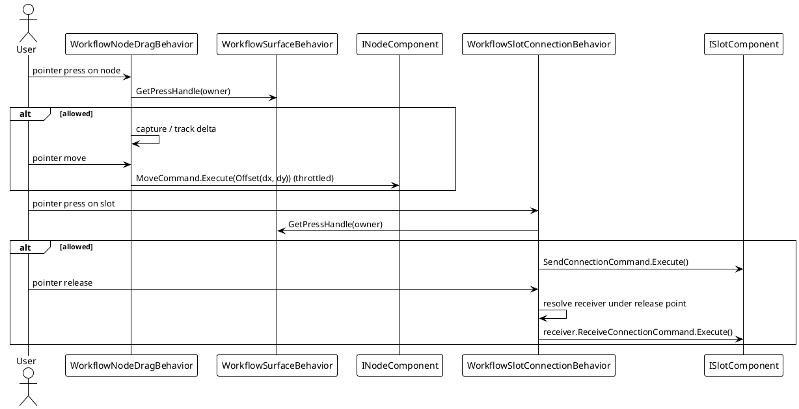

# WinForms 适配器

本页追踪 WinForms 表面从静态附加配置到 Core 输入路由，然后是拖动、连接与覆盖层链路。

WinForms 没有依赖属性。配置是 `WorkflowSurfaceBehavior` 上的一组静态 setter（`SetCanvasName`、`SetScrollViewerName`、`SetPointerPressSourceName` 等），以宿主 `Control` 为键。表面本身是一个 Easel `VisualHost`。

## 挂载表面

`IsEnabled` 挂载。之后的任何配置变化都会重新解析命名部件、树、视图池与相机，再重新挂载子行为。正是这次重解析让静态 setter 在宿主创建后仍可用。

Source: `Src/Adapters/VeloxDev.WinForms/WorkflowSystem/AttachedBehaviors/WorkflowSurfaceBehavior.cs:400-424`, `434-452`

```csharp
private static void OnIsEnabledChanged(Control target, DependencyPropertyChangedEventArgs e)
{
    if (Equals(e.NewValue, true)) Attach(target);
    else Detach(target);
}

private static void OnConfigurationChanged(Control target, DependencyPropertyChangedEventArgs e)
{
    if (!States.TryGetValue(target, out var state) || !state.Attached) return;

    EnsureParts(target, state);
    EnsureTree(target, state);
    EnsurePool(target, state);
    ApplyCamera(state);
    EnsureAttachedBehaviors(state.Surface ?? state.Root);
}
```

```csharp
private static void Attach(Control host)
{
    var state = GetState(host);
    if (state.Attached) return;
    if (host is not VisualHost visualHost) return;
    // ... wire VisualHost pointer events ...
}
```

## 路由输入

VisualHost 以表面坐标上报指针事件。`RoutePressed` 转到世界坐标、解析目标并路由一个 Core 事件；随后只有在空白表面按下、无订阅者否决、且按下源检查通过时才启动平移。

Source: `Src/Adapters/VeloxDev.WinForms/WorkflowSystem/AttachedBehaviors/WorkflowSurfaceBehavior.cs:1177-1211`

```csharp
private static void RoutePressed(SurfaceState state, DrawingPointF surfacePoint, VisualPointerEventArgs args)
{
    if (state.Tree is not { } tree) return;

    var world = SurfaceToWorld(state.Host!, surfacePoint);
    var target = ResolveTarget(state, surfacePoint);
    var handle = new Wf.WorkflowEventHandle();
    Wf.WorkflowInput.For(tree).Route(new Wf.PointerPressedEventArgs(
        new Wf.Anchor(world.X, world.Y, 0),
        ToModifiers(args.Modifiers),
        state.VisualHost,
        target,
        ToButton(args.Button),
        args.ClickCount,
        handle));

    StorePressHandles(state, surfacePoint, handle);

    if (args.Button == MouseButtons.Left
        && target is null
        && !handle.PreventDefault
        && !IsOverScrollBar(state, surfacePoint)
        && IsWithinPressSource(state, state.VisualHost?.FindElementAt(surfacePoint)))
    {
        state.Panning = true;
        state.PanStart = surfacePoint;
        state.PanStartPan = state.Pan;
        if (state.VisualHost is { } host) host.Capture = true;
    }
}
```

`RouteMoved` 发布指针；虚拟连线可见时按几何报告候选接收口而不是路由悬停。`RouteReleased` 路由松开，让订阅者可以反应。

Source: `Src/Adapters/VeloxDev.WinForms/WorkflowSystem/AttachedBehaviors/WorkflowSurfaceBehavior.cs:1214-1236`

```csharp
private static void RouteMoved(SurfaceState state, DrawingPointF surfacePoint, VisualPointerEventArgs args)
{
    if (state.Tree is not { } tree) return;

    var world = SurfaceToWorld(state.Host!, surfacePoint);
    tree.SetPointerCommand.Execute(new Wf.Anchor(world.X, world.Y, 0));

    if (tree.VirtualLink is { IsVisible: true })
    {
        tree.StandardSetPreviewReceiver(Wf.SlotHitTestEx.HitTest(tree, world.X, world.Y));
        return;
    }

    Wf.WorkflowInput.For(tree).Route(new Wf.PointerMovedEventArgs(
        new Wf.Anchor(world.X, world.Y, 0),
        ToModifiers(args.Modifiers),
        state.VisualHost,
        ResolveTarget(state, surfacePoint),
        new Wf.WorkflowEventHandle()));
    UpdateHover(state);
}
```



## 节点拖动与插槽连接

拖动行为做了节流：指针事件可以超过 100 Hz，而每次 `MoveCommand` 都会重新布局整棵视觉树并重绘整个表面。插槽行为在松开点解析接收方，因为 VisualHost 捕获了发送方。

Source: `Src/Adapters/VeloxDev.WinForms/WorkflowSystem/AttachedBehaviors/WorkflowNodeDragBehavior.cs:185-193`

```csharp
if (node.MoveCommand.CanExecute(new Offset(dx, dy)))
{
    node.MoveCommand.Execute(new Offset(dx, dy));
}
```

Source: `Src/Adapters/VeloxDev.WinForms/WorkflowSystem/AttachedBehaviors/WorkflowSlotConnectionBehavior.cs:82-114`

```csharp
private void OnPointerPressed(object? sender, VisualPointerEventArgs args)
{
    if (args.Button != MouseButtons.Left
        || owner.DataContext is not ISlotComponent slot
        || WorkflowSurfaceBehavior.GetPressHandle(owner)?.PreventDefault == true)
        return;

    slot.SendConnectionCommand.Execute(null);
    args.Handled = true;
}

private void OnPointerReleased(object? sender, VisualPointerEventArgs args)
{
    // ... resolve the element under the release point ...
    for (var current = hit; current is not null; current = current.ParentElement)
    {
        if (current.DataContext is ISlotComponent receiver && !ReferenceEquals(receiver, senderSlot))
        {
            receiver.ReceiveConnectionCommand.Execute(null);
            args.Handled = true;
            return;
        }
    }
}
```



## 覆盖层与视图承载

`WorkflowMinimapOverlay` 在 Easel `VisualElement` 上实现 `IWorkflowMinimapOverlay` 与 `IWorkflowMinimapScrollSource`；`WorkflowInfoOverlay` 绘制信息面板。`ViewPool.ItemsSource` / `TemplateSelector` 是静态附加 setter，创建并替换宿主的 `ViewSourcePipeline`，与 XAML 适配器一致。

Source: `Src/Adapters/VeloxDev.WinForms/WorkflowSystem/AttachedBehaviors/ViewPool.cs:29-60`

```csharp
public static readonly DependencyProperty ItemsSourceProperty = DependencyProperty.RegisterAttached(
    "ItemsSource", typeof(INotifyCollectionChanged), typeof(ViewPool), ...);

public static INotifyCollectionChanged? GetItemsSource(VisualElement element)
    => (INotifyCollectionChanged?)element.GetValue(ItemsSourceProperty);

public static void SetItemsSource(VisualElement element, INotifyCollectionChanged? value)
    => element.SetValue(ItemsSourceProperty, value);
```

## 相关

- [平台适配器契约](../24_平台适配器契约/index.md) —— 本适配器闭合的 Core 表面。
- [WPF 适配器](../25_WPF适配器/index.md) —— 附加属性等价物。
- [工作流条目模板](../32_工作流条目模板/index.md) —— 生成的 WinForms 视图。
