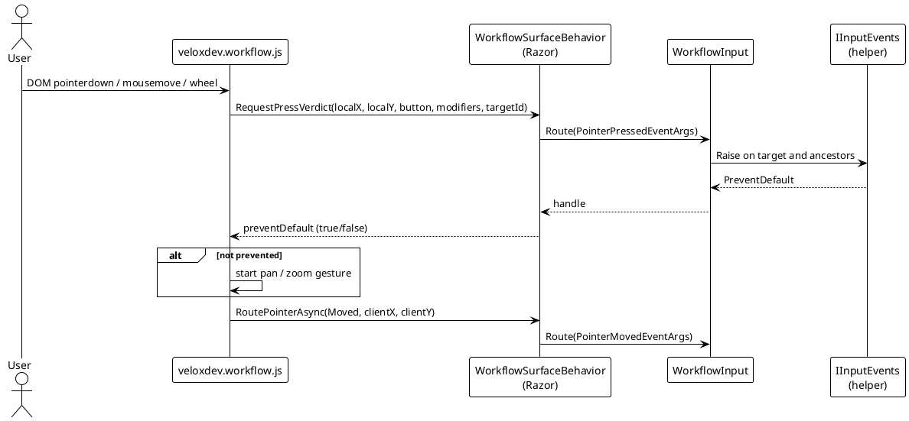
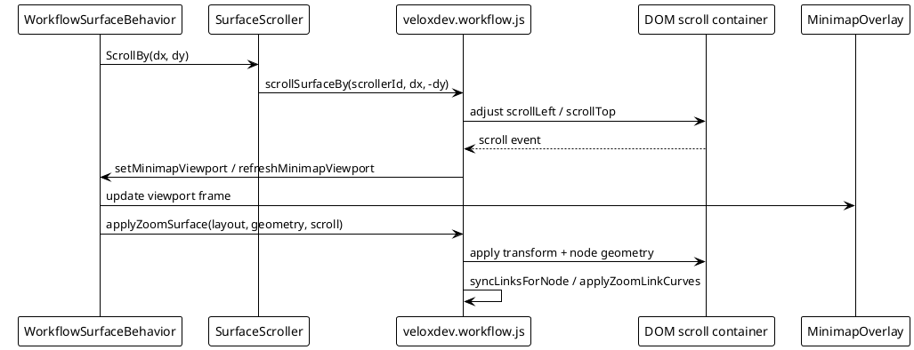

# Razor 适配器

本页追踪 Razor/Blazor 表面从组件参数到 Core 输入路由，然后是拥有 DOM 滚动容器与连线几何的 JavaScript 互操作。

适配器是一组 Razor 组件加一个 ES 模块 `wwwroot/veloxdev.workflow.js`。Blazor 拥有组件模型；JavaScript 拥有浏览器几何与需要逐帧推进的手势。

## 挂载表面

`WorkflowSurfaceBehavior` 是一个 `ComponentBase`，以树为参数并持有一个 `WorkflowInput`。它订阅树、按 id 解析 DOM 滚动容器与画布，并接上 JS 模块的 init 句柄。

Source: `Src/Adapters/VeloxDev.Razor/WorkflowSystem/AttachedBehaviors/WorkflowSurfaceBehavior.razor.cs:22-64`

```csharp
public partial class WorkflowSurfaceBehavior : ComponentBase, IAsyncDisposable
{
    [Parameter] public ITreeComponent? Tree { get; set; }
    [Parameter] public string ScrollViewerId { get; set; } = "veloxdev-wf-scroll";
    [Parameter] public string CanvasId { get; set; } = "veloxdev-wf-canvas";
    // ...
    private WorkflowInput? _input;
}
```

Razor 标记把装饰器、小地图、模板选择器与连线菜单作为表面行为的子片段组合，因此整个表面是一棵组件树。

## 路由输入

`RoutePointerAsync` 把视口坐标换成画布局部坐标，调用方未给目标时从位置解析，并路由对应的 Core 事件。菜单打开时 `WorkflowInput.IsSuspended` 保持指针目标，因此移到菜单上不会清掉它。

Source: `Src/Adapters/VeloxDev.Razor/WorkflowSystem/AttachedBehaviors/WorkflowSurfaceBehavior.razor.cs:493-529`

```csharp
public async Task RoutePointerAsync(
    SurfacePointerKind kind, double clientX, double clientY,
    Wf.MouseButton button = Wf.MouseButton.None, double deltaY = 0, IWorkflowComponent? target = null,
    Wf.InputModifiers modifiers = Wf.InputModifiers.None)
{
    if (_input is not { } input) return;
    if (await ToCanvasLocalAsync(clientX, clientY) is not { } local) return;

    var anchor = new Anchor(local[0], local[1], 0);
    target ??= input.Tree.HitTestVisibleLinks(anchor.Horizontal, anchor.Vertical, input.HitRadius);
    WorkflowEventHandle handle = new();

    input.Route(kind switch
    {
        SurfacePointerKind.Entered => new Wf.PointerEnteredEventArgs(anchor, modifiers, _surfaceRoot, target, handle),
        SurfacePointerKind.Pressed => new Wf.PointerPressedEventArgs(anchor, modifiers, _surfaceRoot, target, button, 1, handle),
        SurfacePointerKind.Wheel => new Wf.PointerWheelEventArgs(anchor, modifiers, _surfaceRoot, target, 0d, deltaY, handle),
        _ => new Wf.PointerMovedEventArgs(anchor, modifiers, _surfaceRoot, target, handle),
    });
}
```

表面还暴露 `[JSInvokable]` 裁决方法。JavaScript 在启动表面自己的手势（画布平移、Ctrl+滚轮缩放）*之前*调用它们，因此订阅者的 `PreventDefault` 在 DOM 改变之前就得到回答。

Source: `Src/Adapters/VeloxDev.Razor/WorkflowSystem/AttachedBehaviors/WorkflowSurfaceBehavior.razor.cs:541-545`

```csharp
[JSInvokable]
public bool RequestPressVerdict(double localX, double localY, int button, int modifiers, string? targetId)
    => Tree is { } tree
       && RoutePress(tree, ResolveComponentTarget(targetId, tree), localX, localY,
              ToButton(button), (Wf.InputModifiers)modifiers).PreventDefault;
```



## JavaScript 模块

ES 模块拥有 DOM 几何：把客户端坐标换成画布局部、设置画布尺寸、摆放节点包装、在 SVG 中画连线曲线、滚动表面并驱动小地图视口。每个 `init*` 函数返回 `{ dispose() }` 句柄，组件在拆卸时处置它。

Source: `Src/Adapters/VeloxDev.Razor/wwwroot/veloxdev.workflow.js:3-6`, `219-241`

```javascript
// Every init* function returns a `{ dispose() }` handle so components can tear down listeners.
```

```javascript
// Scrolls a surface by a pixel delta — the wheel's default scroll, which the adapter applies after
// the same edge-aware path as panning and the minimap (surfaceRegistry's scrollBy), so a wheel at an
// edge grows the canvas instead of stopping.
function scrollSurfaceBy(scrollerId, dx, dy) { /* ... */ }
```

Razor 的 `SurfaceScroller` 通过转发给模块来实现两个 Core 滚动接口：DOM 滚动容器无法在 .NET 侧直接滚动。

Source: `Src/Adapters/VeloxDev.Razor/WorkflowSystem/AttachedBehaviors/WorkflowSurfaceBehavior.razor.cs:1097-1117`

```csharp
private sealed class SurfaceScroller : IWorkflowSurfaceScroller, IWorkflowSurfaceNavigator
{
    private readonly WorkflowSurfaceBehavior owner;

    public void ScrollBy(double wheelDeltaX, double wheelDeltaY)
    {
        var module = owner._module;
        var id = owner.ScrollViewerId;
        if (module is null || string.IsNullOrWhiteSpace(id)) return;

        _ = module.InvokeVoidAsync("scrollSurfaceBy", id, wheelDeltaX, -wheelDeltaY);
    }

    public void CenterOn(double localX, double localY) => _ = owner.CenterOnAsync(localX, localY);
}
```



`ViewPool.razor` 是共享 `ViewSourcePipeline` 的组件包装；`WorkflowGridDecorator.razor` 与 `WorkflowMinimapOverlay.razor` 为浏览器实现 Core 覆盖层接口。`WorkflowGeometryScope` 与 `WorkflowRuntimeIds` 是跨渲染携带画布几何与稳定元素 id 的辅助。

## 相关

- [平台适配器契约](../24_平台适配器契约/index.md) —— 本适配器闭合的 Core 表面。
- [WPF 适配器](../25_WPF适配器/index.md) —— 非互操作的对照。
- [工作流条目模板](../32_工作流条目模板/index.md) —— 生成的 Razor 组件。
