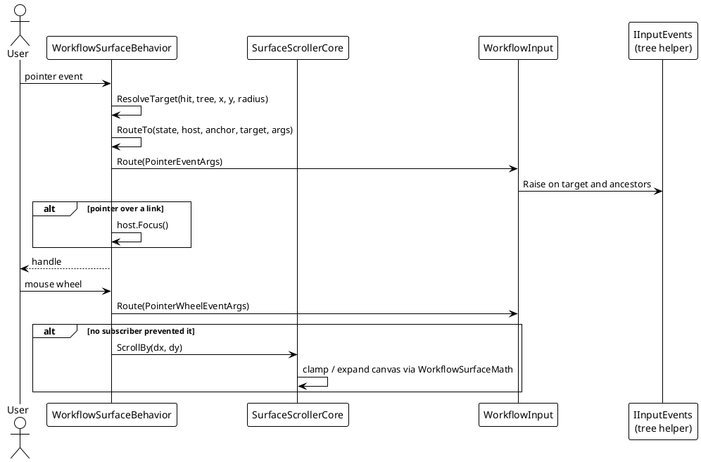
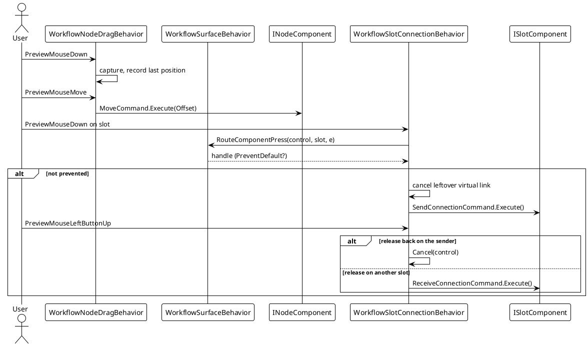

# Jalium 适配器

本页追踪 Jalium 表面从附加属性激活到 Core 输入路由，然后是拖动、连接与连线边界链路。

`WorkflowSurfaceBehavior` 是静态附加属性类。它拥有平台 `ScrollViewer` 适配器，并把 `SurfaceScrollerCore` 同时赋给 `WorkflowInput.Scroller` 与 `WorkflowInput.Navigator`。

## 挂载表面

`IsEnabled` 挂载宿主。配置解析命名部件后，`AttachInteraction` 构建 Core 输入与滚动器、订阅树 helper 的输入 relay，并接上连线移除通知。

Source: `Src/Adapters/VeloxDev.Jalium/WorkflowSystem/AttachedBehaviors/WorkflowSurfaceBehavior.cs:1037-1062`

```csharp
private static void AttachInteraction(SurfaceState state)
{
    if (state.Tree is not { } tree) return;

    var input = WorkflowInput.For(tree);
    state.Input = input;

    var scroller = new SurfaceScrollerCore(new JaliumSurfaceScrollHost(state));
    state.Scroller = scroller;
    input.Scroller = scroller;
    input.Navigator = scroller;

    if (tree.GetHelper() is Wf.IInputEvents events)
    {
        state.InputPressedHandler = (_, e) => OnLinkPointerPressed(state, e);
        events.Input.PointerPressed += state.InputPressedHandler;
    }

    state.LinkRemovedHandler = (_, link) => OnLinkRemoved(state, link);
    tree.GetHelper().LinkRemoved += state.LinkRemovedHandler;
}
```

拆卸路径只在滚动器仍是本表面安装的那一个时才清空它。同一棵树上的两个表面不能拆掉彼此的滚动口。

Source: `Src/Adapters/VeloxDev.Jalium/WorkflowSystem/AttachedBehaviors/WorkflowSurfaceBehavior.cs:1064-1073`

```csharp
private static void DetachInteraction(SurfaceState state)
{
    if (state.Input is { } released && ReferenceEquals(released.Scroller, state.Scroller))
    {
        released.Scroller = null;
        released.Navigator = null;
    }

    state.Scroller = null;
    // ...
}
```

## 路由输入

`RouteTo` 是唯一路由入口。它用一个画布局部点与已解析目标构建事件并路由，然后在指针悬停到连线上时把焦点移给宿主，让 Delete 到达表面。

Source: `Src/Adapters/VeloxDev.Jalium/WorkflowSystem/AttachedBehaviors/WorkflowSurfaceBehavior.cs:1505-1528`

```csharp
private static WorkflowEventHandle RouteTo(
    SurfaceState state, FrameworkElement host, Point anchorPoint, IWorkflowComponent? target,
    Func<Anchor, IWorkflowComponent?, WorkflowEventHandle, Wf.PointerEventArgs> args)
{
    var handle = new WorkflowEventHandle();
    if (state.Input is not { } input) return handle;

    input.Route(args(new Anchor(anchorPoint.X, anchorPoint.Y, 0), target, handle));

    if (input.HoveredLink is not null)
        host.Focus();

    return handle;
}
```

目标解析是适配器的职责，且必须回答节点与插槽，而不只是连线。若只回答连线，`WorkflowInput` 里的 `slot → node → tree` 链就永远走不到。

Source: `Src/Adapters/VeloxDev.Jalium/WorkflowSystem/AttachedBehaviors/WorkflowSurfaceBehavior.cs:1530-1534`

```csharp
// 指针底下是什么，由适配器回答 —— 节点和插槽也是答案的一部分。只认连线的话，路由的 Target 就永远
// 只是「连线或空白」，WorkflowInput.Chain 里 slot → node → tree 那条链于是永远走不到。
private static IWorkflowComponent? ResolveTarget(
    DependencyObject? hit, ITreeComponent tree, double x, double y, double radius)
```



## 节点拖动与插槽连接

拖动以上次位置的增量派发 `MoveCommand`。插槽连接读取表面产生的按下句柄，按下发送、松开接收。松开若回到发送口自身，则取消虚拟连线而不是把插槽连到自己。

Source: `Src/Adapters/VeloxDev.Jalium/WorkflowSystem/AttachedBehaviors/WorkflowNodeDragBehavior.cs:160-180`

```csharp
private static void OnMouseMove(object? sender, MouseEventArgs e)
{
    // ... guard state and coordinate host ...
    var node = ResolveNode(element);
    if (node is null) return;

    var current = e.GetPosition(state.CoordinateHost);
    node.MoveCommand.Execute(new Offset(current.X - state.LastPosition.X, current.Y - state.LastPosition.Y));
    state.LastPosition = current;
}
```

Source: `Src/Adapters/VeloxDev.Jalium/WorkflowSystem/AttachedBehaviors/WorkflowSlotConnectionBehavior.cs:75-129`

```csharp
private static void OnPointerPressed(object? sender, MouseButtonEventArgs e)
{
    // ...
    if (WorkflowSurfaceBehavior.RouteComponentPress(control, slot, e)?.PreventDefault == true) return;
    if (!slot.SendConnectionCommand.CanExecute(null)) return;

    CancelLeftover(control);
    slot.SendConnectionCommand.Execute(null);
    StateOf(control).Sender = slot;
    e.Handled = true;
}

private static void OnPointerReleased(object? sender, MouseButtonEventArgs e)
{
    var state = StateOf(control);

    if (ReferenceEquals(state.Sender, slot))
    {
        Cancel(control);
        e.Handled = true;
        return;
    }

    if (slot.ReceiveConnectionCommand.CanExecute(null))
    {
        slot.ReceiveConnectionCommand.Execute(null);
        state.Sender = null;
        e.Handled = true;
    }
}
```



## 连线边界与视图承载

`WorkflowLinkBounds` 携带适配器绘制的连线层边界，因此离开节点区域的连线仍有被裁剪与命中测试的位置。`ViewSourcePipeline` 在可见项来源上组合 Jalium 的 factory、container、arranger、scheduler 与 diagnostics。

Source: `Src/Adapters/VeloxDev.Jalium/WorkflowSystem/ViewHosting/ViewSourcePipeline.cs:10`

```csharp
public sealed class ViewSourcePipeline : ViewSourcePipelineCore<
    // ... Jalium host, view, item and priority types ...
>
```

小地图是 `WorkflowMinimapOverlay : FrameworkElement, IWorkflowMinimapOverlay`；它作为命名部件（`MinimapOverlayName`）解析，并接收共享 `SurfaceMetrics` 推送。

Source: `Src/Adapters/VeloxDev.Jalium/WorkflowSystem/AttachedBehaviors/WorkflowSurfaceBehavior.cs:560`

```csharp
state.MinimapOverlay = ResolvePart<FrameworkElement>(host, GetMinimapOverlayName(host)) as IWorkflowMinimapOverlay;
```

## 相关

- [平台适配器契约](../24_平台适配器契约/index.md) —— 本适配器闭合的 Core 表面。
- [WPF 适配器](../25_WPF适配器/index.md) —— 最接近的附加属性对照。
- [工作流条目模板](../32_工作流条目模板/index.md) —— 生成的 Jalium 视图。
