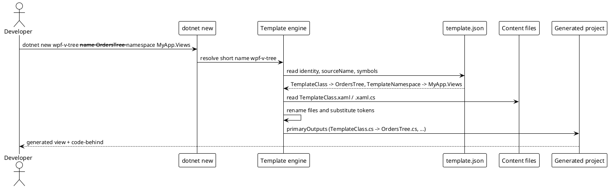
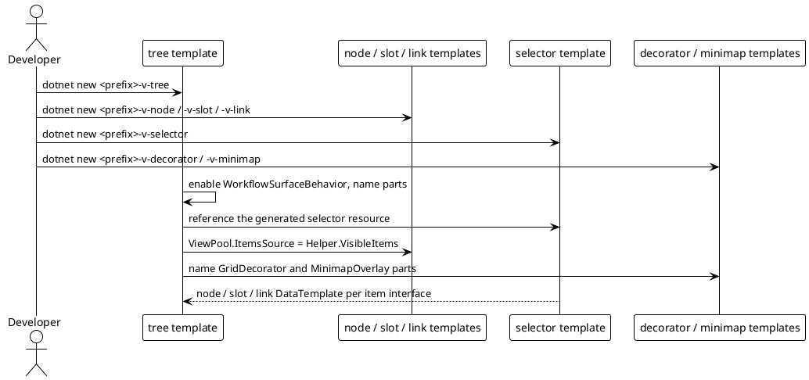

# 工作流条目模板

本页追踪开发者对七个工作流条目包之一运行 `dotnet new` 之后发生什么：模板引擎读取清单、替换类名与命名空间、写出该角色的文件。

共有七个包（`WPF`、`Avalonia`、`WinUI`、`MAUI`、`WinForms`、`Razor`、`Jalium`）与每个包七个角色（`tree`、`node`、`slot`、`link`、`selector`、`decorator`、`minimap`），合计 49 个短名。

## 模板清单

每个角色是 `working/content/workflow-{role}/` 下自己的模板目录，带 `.template.config/template.json`。清单声明 identity、shortName、`sourceName = TemplateClass`，以及替换 `TemplateNamespace` 的 `namespace` 参数。

Source: `Src/Templates/VeloxDev.WPF.Templates/working/content/workflow-tree-view/.template.config/template.json:11-16`

```json
"identity": "VeloxDev.WPF.WorkflowTreeView",
"name": "VeloxDev WPF Workflow Tree View",
"shortName": "wpf-v-tree",
"sourceName": "TemplateClass",
"defaultName": "TreeView",
```

短名前缀是 `wpf`、`ava`、`winui`、`maui`、`winforms`、`razor`、`jalium`；角色后缀是 `-v-tree`、`-v-node`、`-v-slot`、`-v-link`、`-v-selector`、`-v-decorator`、`-v-minimap`。

| 角色 | WPF | Avalonia | WinUI | MAUI | WinForms | Razor | Jalium |
|---|---|---|---|---|---|---|---|
| tree | `wpf-v-tree` | `ava-v-tree` | `winui-v-tree` | `maui-v-tree` | `winforms-v-tree` | `razor-v-tree` | `jalium-v-tree` |
| node | `wpf-v-node` | `ava-v-node` | `winui-v-node` | `maui-v-node` | `winforms-v-node` | `razor-v-node` | `jalium-v-node` |
| slot | `wpf-v-slot` | `ava-v-slot` | `winui-v-slot` | `maui-v-slot` | `winforms-v-slot` | `razor-v-slot` | `jalium-v-slot` |
| link | `wpf-v-link` | `ava-v-link` | `winui-v-link` | `maui-v-link` | `winforms-v-link` | `razor-v-link` | `jalium-v-link` |
| selector | `wpf-v-selector` | `ava-v-selector` | `winui-v-selector` | `maui-v-selector` | `winforms-v-selector` | `razor-v-selector` | `jalium-v-selector` |
| decorator | `wpf-v-decorator` | `ava-v-decorator` | `winui-v-decorator` | `maui-v-decorator` | `winforms-v-decorator` | `razor-v-decorator` | `jalium-v-decorator` |
| minimap | `wpf-v-minimap` | `ava-v-minimap` | `winui-v-minimap` | `maui-v-minimap` | `winforms-v-minimap` | `razor-v-minimap` | `jalium-v-minimap` |

identity 沿用同一形状：`VeloxDev.<Platform>.Workflow<Role>`，例如 `VeloxDev.WinForms.WorkflowTreeView`。

Source: `Src/Templates/VeloxDev.WinForms.Templates/working/content/workflow-tree-view/.template.config/template.json:11-16`

```json
"identity": "VeloxDev.WinForms.WorkflowTreeView",
"name": "VeloxDev WinForms Workflow Tree View",
"shortName": "winforms-v-tree",
"sourceName": "TemplateClass",
"defaultName": "TreeView",
```



## tree 模板接了什么

tree 模板是生成套件的组合根：打开表面行为、命名部件，并把视图池指向树 helper 的可见项。

Source: `Src/Templates/VeloxDev.WPF.Templates/working/content/workflow-tree-view/TemplateClass.xaml:8-15`

```xml
behaviors:WorkflowSurfaceBehavior.IsEnabled="True"
behaviors:WorkflowSurfaceBehavior.ZoomEnabled="True"
behaviors:WorkflowSurfaceBehavior.ScrollViewerName="PART_ScrollViewer"
behaviors:WorkflowSurfaceBehavior.CanvasName="PART_Canvas"
behaviors:WorkflowSurfaceBehavior.GridDecoratorName="PART_GridDecorator"
behaviors:WorkflowSurfaceBehavior.PointerPressSourceName="PART_SurfaceBorder"
behaviors:WorkflowSurfaceBehavior.MinimapOverlayName="PART_MinimapOverlay"
behaviors:WorkflowSurfaceBehavior.LinkMenuKey="LinkContextMenu"
```

Source: `Src/Templates/VeloxDev.WPF.Templates/working/content/workflow-tree-view/TemplateClass.xaml:59-60`

```xml
behaviors:ViewPool.ItemsSource="{Binding Helper.VisibleItems}"
behaviors:ViewPool.TemplateSelector="{StaticResource WorkflowTemplateSelector}"
```

选择器模板是唯一用代码而非标记的角色：它把条目的组件接口映射到 node、slot 或 link 模板，未赋值时抛异常。

Source: `Src/Templates/VeloxDev.WPF.Templates/working/content/workflow-template-selector/TemplateClass.cs:20-30`

```csharp
public override DataTemplate SelectTemplate(object item, DependencyObject container)
    => item switch
    {
        ILinkComponent => LinkTemplate
            ?? throw new InvalidOperationException("LinkTemplate is not set."),
        ISlotComponent => SlotTemplate
            ?? throw new InvalidOperationException("SlotTemplate is not set."),
        INodeComponent => NodeTemplate
            ?? throw new InvalidOperationException("NodeTemplate is not set."),
        _ => throw new InvalidOperationException($"Unsupported workflow item: {item?.GetType().FullName}")
    };
```

## 各平台例外

角色集跨包相同；文件类型与表面承载方式不同。

- **WPF / WinUI** 产出 `.xaml` + `.xaml.cs`；tree 继承 `UserControl`。表面在标记中通过 `WorkflowSurfaceBehavior` 属性挂载。
- **Avalonia** 产出 `.axaml` + `.axaml.cs`；tree 继承 `Avalonia.Controls.UserControl`。
- **MAUI** 产出 `.xaml` + `.xaml.cs`；tree 继承 `ContentView`，并期望在加载前把 `BindingContext` 设为 `ITreeComponent`。
- **WinForms** 在 Easel 上产出 `.xaml` + `.xaml.cs`；tree 继承 `Easel.Visuals.Controls.UserControl`，表面是单个 `VisualHost` 加 `CustomTemplateSelector` 资源。连线菜单是按 key 解析的 `VisualContextMenu` 资源。
- **Razor** 产出 `.razor` + `.razor.cs`；tree 是带 `Tree`、`ScrollViewerId`、`CanvasId`、`NodeTemplate`、`GridSpacing` 参数的 `ComponentBase`，标记组合 `WorkflowSurfaceBehavior`、`GridDecorator`、`MinimapOverlay`、`TemplateSelector` 与 `LinkMenu`。decorator 与 minimap 角色是 Razor 组件，不是 code-behind 类。
- **Jalium** 产出 `.jalxaml` + `.jalxaml.cs`；tree 继承 `UserControl`。由于平台不能绑定附加属性，模板暴露一个转发到 `WorkflowSurfaceBehavior.CanvasTransformProperty` 的 CLR 镜像 `CanvasTransformProperty`。

Source: `Src/Templates/VeloxDev.Jalium.Templates/working/content/workflow-tree-view/TemplateClass.jalxaml.cs:13-16`

```csharp
public static readonly DependencyProperty CanvasTransformProperty = WorkflowSurfaceBehavior.CanvasTransformProperty;

/// <summary>The world-to-view translation the pooled node and link views follow.</summary>
public Transform? CanvasTransform => GetValue(CanvasTransformProperty) as Transform;
```

Source: `Src/Templates/VeloxDev.Razor.Templates/working/content/workflow-tree-view/TemplateClass.razor.cs:8-28`

```csharp
public partial class TemplateClass : ComponentBase
{
    [Parameter] public ITreeComponent? Tree { get; set; }
    [Parameter] public string ScrollViewerId { get; set; } = "veloxdev-wf-scroll";
    [Parameter] public string CanvasId { get; set; } = "veloxdev-wf-canvas";
    [Parameter] public RenderFragment<INodeComponent>? NodeTemplate { get; set; }
    [Parameter] public double GridSpacing { get; set; } = 40;
}
```



模板是起始套件而非封闭集合：每个生成文件都带一条 `VeloxDev customization:` 注释，点名开发者在该处唯一需要改的东西。

## 相关

- [平台适配器契约](../24_平台适配器契约/index.md) —— 这些视图挂载的行为。
- [WPF 适配器](../25_WPF适配器/index.md) —— WPF 套件面向的行为集。
- [Razor 适配器](../30_Razor适配器/index.md) —— Razor 套件面向的组件模型。
- [Jalium 适配器](../31_Jalium适配器/index.md) —— Jalium 套件面向的适配器。
