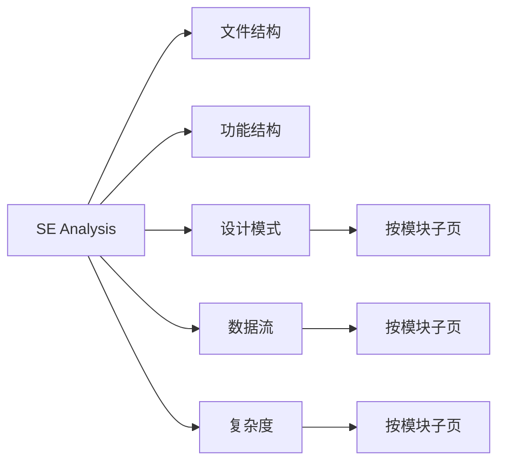

# 软件工程分析

从五个维度分析 VeloxDev 的工程结构。`00_文件结构` 与 `01_功能结构` 是全局概览；`02_设计模式`、`03_数据流`、`04_复杂度` 按功能分模块展开。

| 页面组 | 内容 |
|---|---|
| [文件结构](00_文件结构/index.md) | 仓库布局、源码目录树、项目与目录的映射 |
| [功能结构](01_功能结构/index.md) | 模块职责边界、功能与项目的映射、入口 |
| [设计模式](02_设计模式/index.md) | 每个功能的设计模式分析（Mermaid 类图） |
| [数据流](03_数据流/index.md) | 每个功能的核心调用链（PlantUML 时序图） |
| [复杂度](04_复杂度/index.md) | 每个功能核心操作的时间/空间复杂度（KaTeX） |
